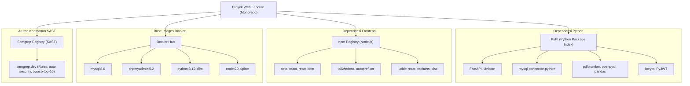

# 📦 Daftar Repositori, Sumber Daya, dan Skill AI yang Digunakan

Dokumen ini mencatat seluruh repositori kode sumber, sumber daya pihak ketiga, registry paket, serta pustaka skill AI yang digunakan dalam pengembangan dan pemeliharaan aplikasi **Web Laporan Keuangan & Rekonsiliasi Kas Satker**.

---

## 1. Repositori Utama Kode Sumber (*Application Repository*)

Seluruh sistem aplikasi dikelola dalam format **Monorepo** pada GitHub:

- **Nama Repositori**: `WEB-MAGANG-`
- **URL Remote GitHub**: [`https://github.com/Adivalisna1/WEB-MAGANG-.git`](https://github.com/Adivalisna1/WEB-MAGANG-.git)
- **Branch Utama**: `main`
- **Arsitektur**: Monorepo Fullstack terpadu dengan Docker Compose

### Struktur Modul di dalam Repositori:
| Folder / Modul | Teknologi | Peran & Deskripsi |
| :--- | :--- | :--- |
| **`frontend/`** | Next.js 14, React 18, Tailwind CSS, TypeScript, Lucide | Antarmuka pengguna (*User Interface*) multi-role (Staff Satker, Pimpinan Satker, Operator/Pimpinan Eselon 1, Admin IT, K/L). |
| **`backend_py/`** | Python 3.12, FastAPI, PyJWT, Bcrypt, PDFPlumber | Backend API utama berkinerja tinggi, otorisasi granular berbasis token, parser AI/ekstraksi file rekening koran PDF, dan isolasi data per satker. |
| **`backend/`** | Node.js, Express.js | Layanan pendukung legacy dan modul integrasi bot pesan instan. |
| **`database/`** | MySQL 8.0, SQL Migrations | Skema database relasional, migrasi v1 hingga v10, dan data awalan (*seeding*) akun pengguna berjenjang. |
| **`docker-compose.yml`** | Docker & Docker Compose | Orkestrasi container lokal: Database MySQL (`port 3307`), FastAPI (`port 5000`), Next.js (`port 3000`), dan phpMyAdmin (`port 8080`). |

---

## 2. Repositori & Plugin Skill AI (*Antigravity AI Capabilities*)

Dalam menganalisis, mengaudit keamanan, memeriksa UX, dan mengoptimalkan kode aplikasi ini, asisten AI **Antigravity** memanfaatkan kapabilitas dari paket plugin dan skill berikut:

### A. Modern Web Guidance Plugin
- **Penyedia**: Google Antigravity Modern Web Ecosystem
- **Skill yang Dipakai**:
  - `modern-web-guidance`: Panduan standar terkini untuk HTML5/CSS, Next.js App Router, SSR/CSR hydration, responsive UI, Tailwind CSS, dan aksesibilitas (a11y).
  - `chrome-extensions`: Best-practice arsitektur Manifest V3 dan integrasi web modern.

### B. Chrome DevTools Plugin (MCP)
- **Penyedia**: Chrome DevTools Model Context Protocol (MCP)
- **Skill yang Dipakai**:
  - `chrome-devtools`: Inspeksi DOM, otomatisasi uji browser headless, penelusuran traffic network/API.
  - `a11y-debugging`: Audit aksesibilitas warna kontras, keyboard navigation, dan ARIA role untuk pegawai instansi.
  - `debug-optimize-lcp`: Analisis performa pemuatan laman (Largest Contentful Paint & Core Web Vitals).
  - `memory-leak-debugging`: Analisis kebocoran memori heap JavaScript pada tabel data besar.

### C. Antigravity Built-in Core Skills
- **Penyedia**: Google DeepMind Agentic Coding Framework
- **Skill yang Dipakai**:
  - `generative_ui`: Penyusunan visualisasi diagram alur, widget interaktif, dan format laporan terstruktur.
  - `automation`: Eksekusi tugas terotomatisasi multi-langkah dan pemantauan status proses latar belakang.
  - `antigravity-guide`: Referensi kapabilitas ekosistem agentic coding, context compression, dan slash commands.

### D. Android Tooling Plugin *(Tersedia di Lingkungan)*
- **Penyedia**: Official Android CLI Plugin
- **Skill**: `android-cli`, `device-hub`, `compose-preview` *(untuk interoperabilitas lintas perangkat)*.

---

## 3. Registry Paket & Dependensi Pihak Ketiga (*Package Repositories*)

Aplikasi dan sistem pendukungnya menarik dependensi resmi dari beberapa repositori paket global:

### Detail Sumber Registry:
1. **PyPI (`https://pypi.org/`)**:
   - Sumber pustaka backend Python (`backend_py/requirements.txt`).
2. **npm Registry (`https://registry.npmjs.org/`)**:
   - Sumber pustaka React/Next.js frontend (`frontend/package.json`).
3. **Docker Hub (`https://hub.docker.com/`)**:
   - Penyedia image resmi container Docker (`mysql`, `phpmyadmin`, `node`, `python`).
4. **Semgrep Rules Registry (`https://semgrep.dev/`)**:
   - Basis aturan analisis statis (*Static Application Security Testing / SAST*) yang digunakan untuk memindai celah otorisasi, IDOR, SQL injection, dan keamanan token.

---

## 4. Ringkasan Singkat

| Kategori | Nama / Sumber | Lokasi / Tautan |
| :--- | :--- | :--- |
| **Repositori Kode Sumber** | `WEB-MAGANG-` (Monorepo) | [`https://github.com/Adivalisna1/WEB-MAGANG-.git`](https://github.com/Adivalisna1/WEB-MAGANG-.git) |
| **Koleksi AI Skill** | Google Antigravity & Chrome DevTools Plugins | Terintegrasi langsung di lingkungan runtime AI Antigravity |
| **Package Registries** | PyPI, npm, Docker Hub, Semgrep | Sumber dependensi pustaka & container pihak ketiga |
