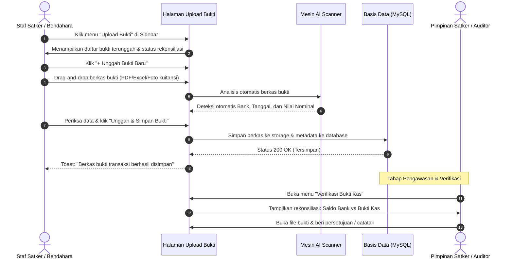

# 📋 Cetak Biru Perubahan UX: Transformasi Menu "Pencatatan" Menjadi "Upload Bukti"

> [!NOTE]
> Dokumen ini dirancang sebagai panduan lengkap perombakan antarmuka pengguna (*User Experience / UX Architecture*) dari perspektif pegawai instansi pemerintah, bendahara satker, dan auditor non-teknis IT.

---

## 1. Latar Belakang & Analisis Masalah (*Problem Statement*)

Saat ini pada sistem pelaporan keuangan satker, terdapat menu sidebar dengan ikon kalkulator bertuliskan **"Pencatatan"**.

### Mengapa Istilah "Pencatatan" Membingungkan Pegawai Instansi?

1. **Beban Mental Model (*Cognitive Load*)**:
   - Kata *"Pencatatan"* diasosiasikan oleh bendahara dan staf administrasi dengan penjurnalan akuntansi manual yang rumit (*double-entry bookkeeping*, penentuan akun debit/kredit, pembukuan besar GL).
   - Ikon **Kalkulator** (`Calculator`) memperkuat kesan bahwa pengguna harus menghitung angka manual layaknya kalkulator pajak atau mesin hitung kas.
2. **Kenyataan Alur Kerja Nyata di Satker (*Actual Operational Flow*)**:
   - Inti dari fitur ini sebenarnya adalah **mengunggah berkas bukti transaksi / dokumen kas** (misal: lembar rekening koran bank, kuitansi belanja modal/barang, SPJ, nota debet/kredit).
   - Pengguna kemudian memanfaatkan fitur **AI Auto-Scan** untuk mengekstrak data nominal dan tanggal secara otomatis, lalu mencocokkannya dengan buku kas.
3. **Kebutuhan Auditor & Pengawas (Inspektorat / BPK / BPKP)**:
   - Dalam audit kepatuhan, pertanyaan pertama auditor adalah: *"Mana bukti fisiknya (evidence/voucher)? Apakah bukti sudah diunggah lengkap?"*.
   - Menggunakan terminologi **"Upload Bukti"** atau **"Bukti Transaksi"** langsung menyelaraskan sistem dengan bahasa kerja sehari-hari instansi pemerintah.

---

## 2. Konsep Transformasi UX: Menuju *Action-Oriented UX*

Dengan mengubah identitas menu menjadi **"Upload Bukti"** (atau **"Upload Bukti Kas"**), pengguna langsung memahami tindakan konkret yang harus mereka ambil begitu membuka menu tersebut.

```mermaid
flowchart TD
    subgraph Mental Model Lama
        A1["Menu: 'Pencatatan'"] --> A2["Ikon: Kalkulator 🧮"]
        A2 --> A3["Staf Berpikir: 'Harus jurnal manual debit/kredit?'"]
        A3 --> A4["Ragu mengklik & rentan salah input"]
    end

    subgraph Mental Model Baru (Rekomendasi)
        B1["Menu: 'Upload Bukti'"] --> B2["Ikon: FileUp / UploadCloud 📤"]
        B2 --> B3["Staf Berpikir: 'Upload berkas SPJ / Bukti Bank ke sini'"]
        B3 --> B4["Langsung upload dokumen -> AI mendeteksi -> Verifikasi"]
    end
```

---

## 3. Matriks Perubahan Terminologi Lengkap (*Before vs After*)

Berikut adalah pemetaan perubahan redaksi (*microcopy*) di seluruh antarmuka aplikasi:

| Komponen UI | Terminologi Lama | Terminologi Baru (Rekomendasi) | Alasan Perubahan |
| :--- | :--- | :--- | :--- |
| **Ikon Menu Sidebar** | `Calculator` (Kalkulator) | `FileUp` atau `UploadCloud` | Menunjukkan aksi unggah dokumen secara visual |
| **Label Menu Sidebar (Staff)** | `Pencatatan` | `Upload Bukti` *(atau `Upload Bukti Kas`)* | Langsung to-the-point mengenai tugas staf |
| **Label Menu Sidebar (Pimpinan)**| `Pencatatan` | `Verifikasi Bukti Kas` | Menjelaskan peran pimpinan dalam memeriksa bukti |
| **Label Menu Sidebar (Eselon 1)** | `Pencatatan Kas Satker` | `Monitoring Bukti Satker` | Menegaskan fungsi pengawasan unit eselon pusat |
| **Header Halaman (Staff)** | `Pencatatan Kas & Transaksi` | `Unggah & Kelola Bukti Transaksi` | Menghilangkan kesan teknis akuntansi yang kaku |
| **Sub-Header Deskripsi** | `Kelola transaksi, kategori, dan upload berkas pendukung` | `Unggah berkas bukti transaksi (PDF/Gambar/Excel) untuk rekonsiliasi kas` | Menjelaskan format dan tujuan file bukti |
| **Tombol Aksi Utama (CTA)** | `+ Tambah Pencatatan` | `+ Unggah Bukti Baru` | Jelas merupakan aksi unggah berkas baru |
| **Header Modal Form** | `Tambah Pencatatan Baru` | `Unggah Berkas Bukti Transaksi` | Memberikan kejelasan konteks pop-up formulir |
| **Field Unggah Berkas** | `Bukti File / Berkas Transaksi` | `Berkas Bukti Dukung (PDF / Foto / Excel) *` | Menjelaskan jenis berkas yang sah |
| **Keterangan AI Scanner** | `Format PDF Rekening Koran akan dibaca otomatis oleh AI...` | `AI akan memindai berkas bukti otomatis untuk mengisi Nama Bank, Nominal, dan Periode.` | Ramah pengguna awam |
| **Tombol Submit** | `Simpan Pencatatan` | `Unggah & Simpan Bukti` | Memastikan pengguna tahu berkas ikut tersimpan |
| **Placeholder Pencarian** | `Cari uraian pencatatan...` | `Cari keterangan bukti transaksi...` | Konsisten dengan konsep bukti |
| **Judul Kolom Tabel** | `Uraian Pencatatan` | `Uraian / Keterangan Bukti` | Standar laporan pembukuan kas |
| **Pesan Kosong (Empty State)** | `Belum ada data pencatatan.` | `Belum ada berkas bukti yang diunggah.` | Menstimulasi staf untuk mulai mengunggah |
| **Notifikasi Sukses** | `Pencatatan berhasil disimpan` | `Berkas bukti transaksi berhasil diunggah & disimpan` | Konfirmasi jelas bahwa file masuk sistem |

---

## 4. Alur Kerja Pengguna Baru (*User Journey Walkthrough*)



---

## 5. Rencana Perubahan Komponen (*Affected Code Blueprint*)

Berikut adalah berkas-berkas yang akan diperbarui saat fase pengerjaan disetujui:

### A. Komponen Navigasi (Sidebar)
1. **`frontend/src/components/Staff/StaffSidebar.tsx`**:
   - Ganti ikon `Calculator` menjadi `FileUp` dari `lucide-react`.
   - Ubah `label: 'Pencatatan'` $\rightarrow$ `label: 'Upload Bukti'`.
2. **`frontend/src/components/pimpinan/PimpinanSidebar.tsx`**:
   - Ganti ikon `Calculator` menjadi `FileCheck` atau `FileSpreadsheet`.
   - Ubah `label: 'Pencatatan'` $\rightarrow$ `label: 'Verifikasi Bukti'`.
3. **`frontend/src/components/eselon-1/Eselon1Sidebar.tsx`**:
   - Ubah `label: 'Pencatatan Kas'` $\rightarrow$ `label: 'Monitoring Bukti Kas Satker'`.
4. **`frontend/src/components/admin-it/AdminITSidebar.tsx`**:
   - Ubah `label: 'Pencatatan'` $\rightarrow$ `label: 'Master Bukti & Transaksi'`.

### B. Halaman Antarmuka (Pages)
1. **`frontend/src/app/staff/pencatatan/page.tsx`**:
   - Ganti judul halaman: `"Pencatatan Kas & Transaksi"` $\rightarrow$ `"Unggah & Kelola Bukti Transaksi"`.
   - Ganti tombol aksi: `"+ Tambah Pencatatan"` $\rightarrow$ `"+ Unggah Bukti Baru"`.
   - Ganti modal header: `"Tambah Pencatatan Baru"` $\rightarrow$ `"Unggah Berkas Bukti Transaksi"`.
   - Perbarui pesan toast feedback agar selaras dengan terminologi "Bukti".
2. **`frontend/src/app/pimpinan/pencatatan/page.tsx`**:
   - Ganti judul: `"Verifikasi Bukti Transaksi Kas Satker"`.
   - Perjelas fungsi audit sandingan antara Bukti Transaksi dengan Rekening Koran.
3. **`frontend/src/app/eselon-1/pencatatan/page.tsx`**:
   - Ganti nama berkas ekspor Excel: `"Rekap_Bukti_Kas_Satker_...xlsx"`.

> [!TIP]
> **Rekomendasi Arsitektur Routing & Database:**
> URL rute frontend (`/staff/pencatatan`) dan API endpoint (`/api/pencatatan`) **sebaiknya tetap dipertahankan** di level kode backend/database. Hal ini menjamin:
> - Tidak ada *breaking changes* pada tabel MySQL atau API contract.
> - Seluruh perubahan hanya berada pada lapisan presentasi (**UX/UI Layer**), sehingga aman dari risiko bug sistem atau regresi data.

---

## 6. Kesimpulan & Nilai Tambah (*Value Added*)

Dengan mentransformasikan konsep dari **"Pencatatan"** menjadi **"Upload Bukti"**:
1. **Kurva Belajar Nol (*Zero Learning Curve*)**: Pegawai baru di satker langsung mengerti tugasnya tanpa perlu pelatihan istilah akuntansi yang rumit.
2. **Kesiapan Audit Lebih Tinggi**: Setiap transaksi secara natural langsung terhubung dengan file fisik pendukungnya.
3. **Tingkat Adopsi Sistem Meningkat**: Menghilangkan ketakutan staf instansi terhadap istilah pembukuan teknis.

