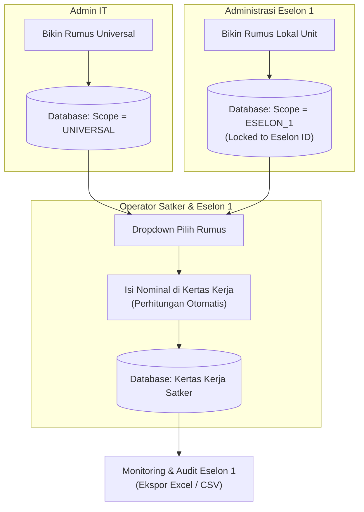
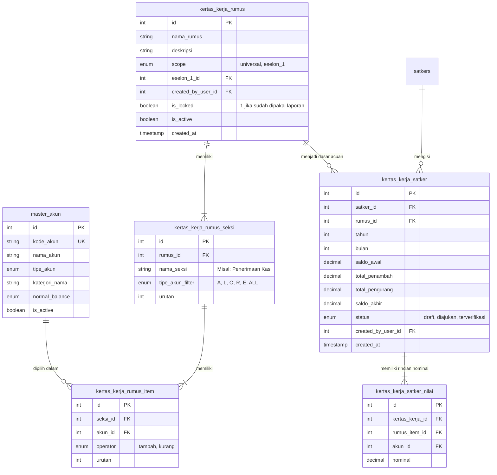
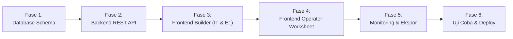

# Product Requirement Document (PRD) & Implementation Plan
## Fitur: Kertas Kerja Dinamis & Accounting Rule Engine
**Tanggal Dokumen:** 10 November 2026  
**Status:** DRAFT - Siap Dieksekusi  
**Target Pengguna:** Admin IT, Administrasi Eselon 1, Operator Satker & Eselon 1  

---

## 1. Executive Summary & Problem Statement

### 1.1 Latar Belakang
Selama ini, perhitungan laporan keuangan dan rekonsiliasi kas satker sering kali bersifat kaku (*hardcoded*) di dalam sistem atau dilakukan secara manual di lembar kerja Excel oleh masing-masing satker. Hal ini memicu beberapa kendala:
- **Tingginya Risiko Human Error:** Operator satker sering salah memasukkan rumus penjumlahan/pengurangan di Excel.
- **Ketergantungan Programmer:** Jika ada perubahan regulasi atau format laporan baru dari Kementerian, tim teknis harus mengubah kodingan dari nol.
- **Ketiadaan Standardisasi:** Format kertas kerja antar-satker sering berbeda sehingga menyulitkan Eselon 1 dalam mengkonsolidasi data.

### 1.2 Solusi
Membangun fitur **"Kertas Kerja & Accounting Rule Engine"**:
1. **Rule Engine (Pembangun Rumus Dinamis):** Admin IT dan Administrasi Eselon 1 dibekali kanvas fleksibel untuk meracik seksi laporan, memilih akun-akun pemerintahan (Bagan Akun Standar / BAS), dan menentukan operasi penambah `(+)` atau pengurang `(-)`.
2. **Kertas Kerja Mandiri (Operator View):** Operator satker hanya perlu memilih rumus dari dropdown. Sistem langsung menyajikan formulir satu layar penuh yang terstruktur; operator hanya mengisi nominal rupiah tanpa perlu memikirkan logika matematika rumus.
3. **Proteksi Audit (*Lock Rule*):** Rumus yang sudah digunakan dalam transaksi otomatis dikunci demi integritas laporan masa lalu.
4. **Audit & Ekspor Terpadu:** Eselon 1 dapat memantau dan mengekspor seluruh hasil kertas kerja satker binaannya ke format Excel (`.xlsx`) dan CSV (`.csv`).

---

## 2. Matriks Hak Akses & Cakupan Rumus (*Scope*)

| Peran (Role) | Akses Menu | Hak Akses Rumus | Cakupan (*Scope*) Rumus |
| :--- | :---: | :--- | :--- |
| **Admin IT** | Manajemen Rumus & Kertas Kerja | **Membuat, Melihat Keterhubungan Akun, & Menguji** | **🌐 UNIVERSAL** Rumus otomatis tersedia untuk seluruh Operator Satker dan Eselon 1 se-Indonesia. |
| **Administrasi Eselon 1** | Manajemen Rumus & Kertas Kerja | **Membuat & Memilih Rumus** | **🏛️ LOKAL UNIT** Rumus hanya tersedia untuk Operator di bawah naungan unit Eselon 1 tersebut. |
| **Operator (Satker / Eselon 1)** | **Kertas Kerja** | **Hanya Memilih (Read-Only Logic)** | Memilih rumus dari dropdown, input nominal manual, tidak bisa mengubah logika rumus. |

---

## 3. Spesifikasi Fungsional (Functional Requirements)

### FR-1: Master Akun Pemerintahan (Telah Siap)
- Sistem telah mengimpor **3.795 Akun Standar BAS** ke tabel `master_akun`:
  - **Tipe A (Aset)**: 830 akun (Kepala `1xxxxx`)
  - **Tipe L (Liabilitas)**: 354 akun (Kepala `2xxxxx`)
  - **Tipe O (Ekuitas)**: 84 akun (Kepala `3xxxxx`)
  - **Tipe R (Pendapatan)**: 1.042 akun (Kepala `4xxxxx`)
  - **Tipe E (Beban & Belanja)**: 1.485 akun (Kepala `5xxxxx`)
- Admin IT dapat menambahkan akun baru secara manual jika terdapat pembaruan regulasi.

### FR-2: Kanvas Pembuat Rumus Dinamis (*Formula Builder*)
- **Formulir Kosong Modular:** Admin dapat menambah kelompok baris / seksi secara bebas (contoh: Seksi I: Aset Kas, Seksi II: Penerimaan Titipan, Seksi III: Belanja Kas).
- **Smart Context-Aware Filter:**
  - Saat memilih kategori **Aset**, dropdown pencarian akun **hanya menampilkan akun tipe `A` (kepala 1)**.
  - Saat memilih kategori **Liabilitas**, hanya menampilkan akun tipe `L` (kepala 2).
  - Begitu seterusnya untuk Ekuitas (`O`), Pendapatan (`R`), dan Belanja (`E`).
- **Penentu Operasi Akun (+ / -):**
  - Tiap akun di dalam seksi memiliki toggle: **`(+) Penambah`** atau **`(-) Pengurang`**.
  - Mengakomodasi akun normal maupun kontra-aset (misal akumulasi penyusutan, penyisihan piutang, mutasi keluar).
- **Simulasi & Preview Rumus:** Tombol simulasi untuk menguji kalkulasi rumus dengan angka dummy sebelum disimpan.

### FR-3: Lembar Kertas Kerja Operator (*Worksheet Screen*)
- **Pilihan Dropdown:** Menampilkan daftar rumus yang relevan (Universal dari IT + Lokal dari Eselon 1 pembinanya).
- **Antarmuka 1 Layar Penuh:**
  - Baris Saldo Awal (input angka).
  - Seksi-seksi terstruktur sesuai rancangan rumus yang dipilih.
  - Input nominal angka per akun dengan format ribuan instan (`Rp`).
  - Subtotal per seksi terhitung otomatis secara *live*.
  - Baris Saldo Akhir terhitung otomatis secara *realtime*:
    $$\text{Saldo Akhir} = \text{Saldo Awal} + \sum(\text{Subtotal Penambah}) - \sum(\text{Subtotal Pengurang})$$
- **Penyimpanan:** Disimpan ke database dengan mengikat `satker_id`, `periode_bulan`, `periode_tahun`, dan `rumus_id`.

### FR-4: Proteksi Audit (*Audit Lock Rule*)
- Jika suatu rumus sudah pernah digunakan pada data kertas kerja satker yang tersimpan di database, rumus tersebut **otomatis terkunci (`is_locked = 1`)**.
- Rumus yang terkunci tidak dapat diedit atau dihapus sembarangan untuk menjamin validitas laporan masa lalu.

### FR-5: Monitoring Eselon 1 & Mesin Ekspor
- Administrasi dan Pimpinan Eselon 1 dapat melihat daftar kertas kerja yang sudah diisi seluruh satker binaannya.
- Fitur Ekspor:
  - **Excel (`.xlsx`)**: Berisi header satker, tanggal, rincian per baris akun, subtotal, dan saldo akhir.
  - **CSV (`.csv`)**: Format tabular baku untuk kebutuhan integrasi data.

---

## 4. Desain Skema Database (Database Architecture)

---

## 5. Rencana Eksekusi Bertahap (Implementation Plan)

### 🔹 Fase 1: Migrasi Skema Database Lanjutan
- [x] **Langkah 1.1**: Buat tabel `master_akun` dan impor 3.795 data BAS *(SELESAI)*.
- [ ] **Langkah 1.2**: Buat skrip migrasi untuk tabel `kertas_kerja_rumus`, `kertas_kerja_rumus_seksi`, dan `kertas_kerja_rumus_item`.
- [ ] **Langkah 1.3**: Buat skrip migrasi untuk tabel `kertas_kerja_satker` dan `kertas_kerja_satker_nilai`.
- [ ] **Langkah 1.4**: Eksekusi migrasi di MySQL Docker port 3307.

### 🔹 Fase 2: Backend REST API (FastAPI)
- [ ] **Langkah 2.1**: Buat router `backend_py/routers/kertas_kerja.py`.
- [ ] **Langkah 2.2**: Endpoint Master Akun (`GET /api/kertas-kerja/akun` dengan filter tipe A/L/O/R/E dan keyword search autocomplete).
- [ ] **Langkah 2.3**: Endpoint CRUD Rumus (`GET`, `POST`, `PUT`, `DELETE /api/kertas-kerja/rumus`) dengan validasi `scope` (universal vs eselon_1) dan pengecekan proteksi `is_locked`.
- [ ] **Langkah 2.4**: Endpoint Eksekusi Kertas Kerja Satker (`GET`, `POST /api/kertas-kerja/transaksi`).
- [ ] **Langkah 2.5**: Endpoint Ekspor Excel & CSV (`GET /api/kertas-kerja/export/{id}?format=xlsx|csv`).

### 🔹 Fase 3: Antarmuka Pembuat Rumus (Admin IT & Administrasi Eselon 1)
- [ ] **Langkah 3.1**: Buat halaman manajemen rumus di `/it/rumus-kertas-kerja` dan `/eselon-1/rumus-kertas-kerja`.
- [ ] **Langkah 3.2**: Rancang antarmuka kanvas kosong:
  - Tombol `[ + Tambah Seksi/Baris ]`.
  - Smart Context-Filter Akun (Aset hanya muncul Aset, Belanja hanya muncul Belanja).
  - Toggle `[+] Penambah` (hijau) dan `[-] Pengurang` (merah).
- [ ] **Langkah 3.3**: Tambahkan widget "Simulasi Cepat" untuk menguji logika rumus sebelum disimpan.

### 🔹 Fase 4: Antarmuka Kertas Kerja Operator
- [ ] **Langkah 4.1**: Tambahkan menu **"Kertas Kerja"** pada Sidebar Operator (Satker dan Eselon 1).
- [ ] **Langkah 4.2**: Rancang tampilan 1 layar penuh:
  - Header: Dropdown pilih rumus + filter periode (bulan/tahun).
  - Formulir otomatis: Terbagi per seksi rancangan rumus.
  - Perhitungan *live real-time* saat nominal diinput.
  - Tombol Simpan & Status Laporan.

### 🔹 Fase 5: Monitoring Eselon 1 & Mesin Ekspor
- [ ] **Langkah 5.1**: Halaman peninjauan Kertas Kerja Satker Binaan di menu Eselon 1.
- [ ] **Langkah 5.2**: Modal/Slide-over audit untuk melihat lembar kerja detail per satker.
- [ ] **Langkah 5.3**: Integrasikan tombol unduh **Excel (.xlsx)** dan **CSV (.csv)**.

### 🔹 Fase 6: Uji Coba, Verifikasi, & Deployment
- [ ] **Langkah 6.1**: Uji coba pembuatan rumus Universal oleh Admin IT.
- [ ] **Langkah 6.2**: Uji coba pembuatan rumus Lokal oleh Admin Eselon 1 Dikti.
- [ ] **Langkah 6.3**: Uji coba pengisian kertas kerja oleh Operator Satker.
- [ ] **Langkah 6.4**: Uji coba proteksi *lock* (pastikan rumus yang sudah dipakai tidak bisa diedit sembarangan).
- [ ] **Langkah 6.5**: Commit & Push ke GitHub, restart Docker frontend/backend.
