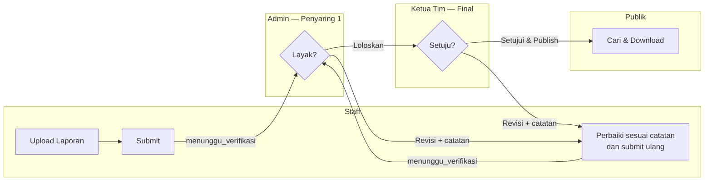
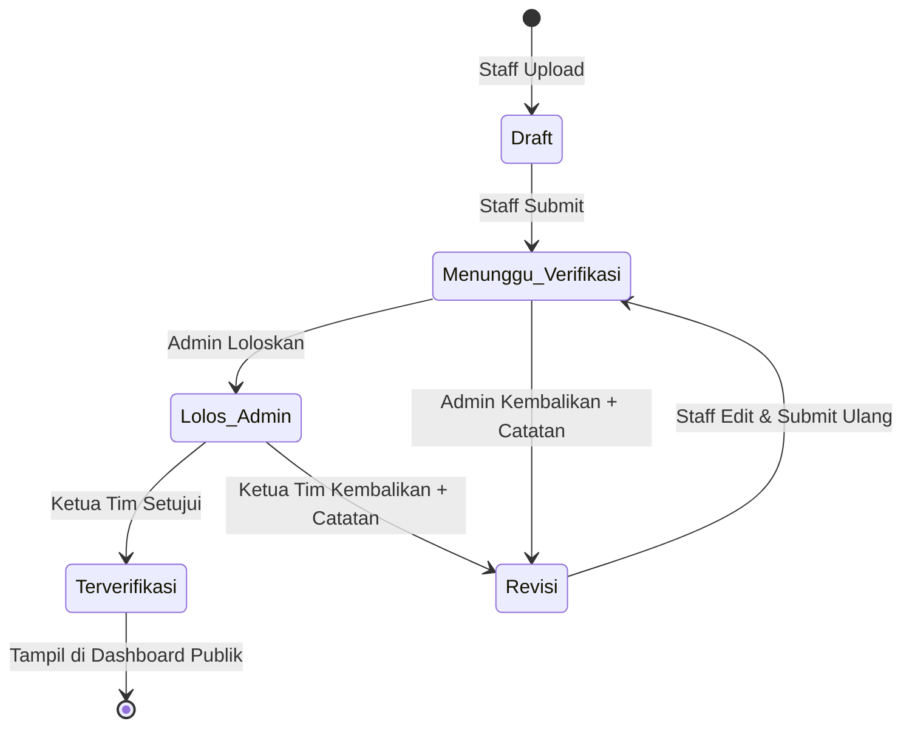
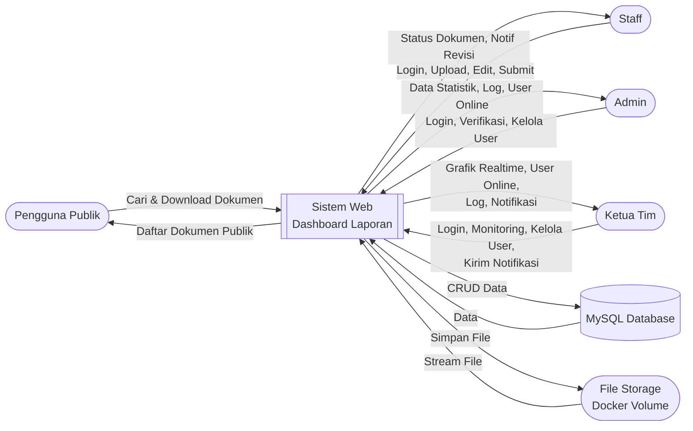
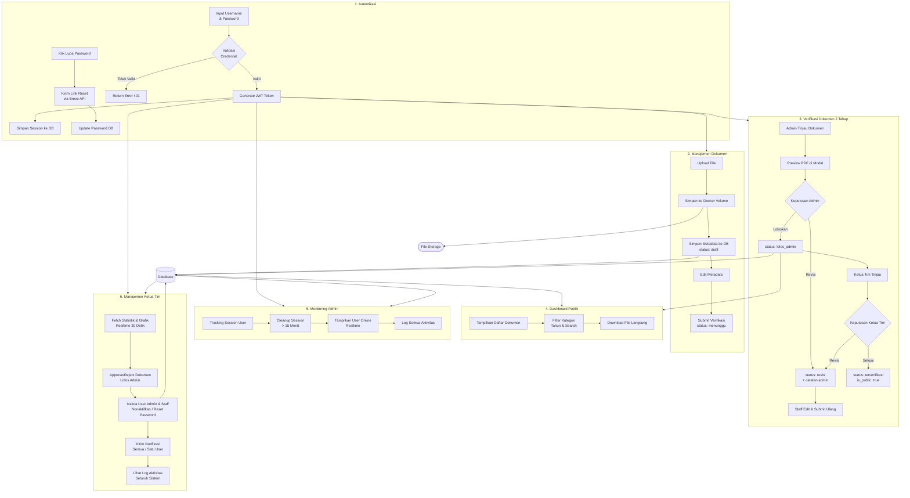
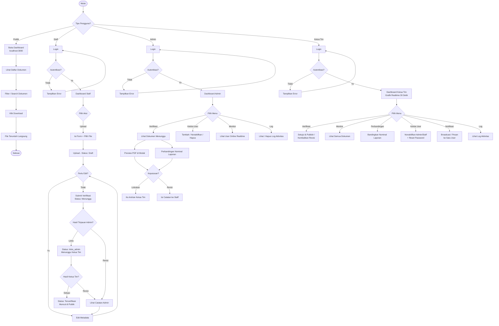
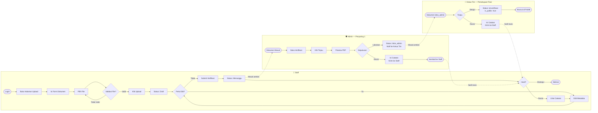
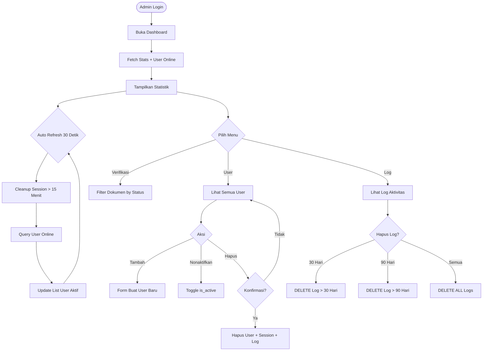
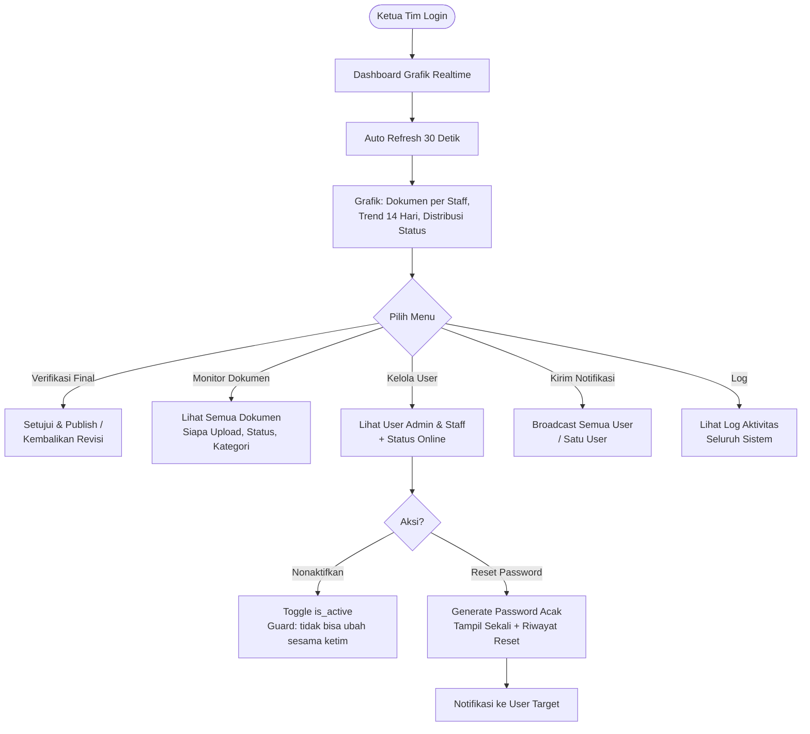
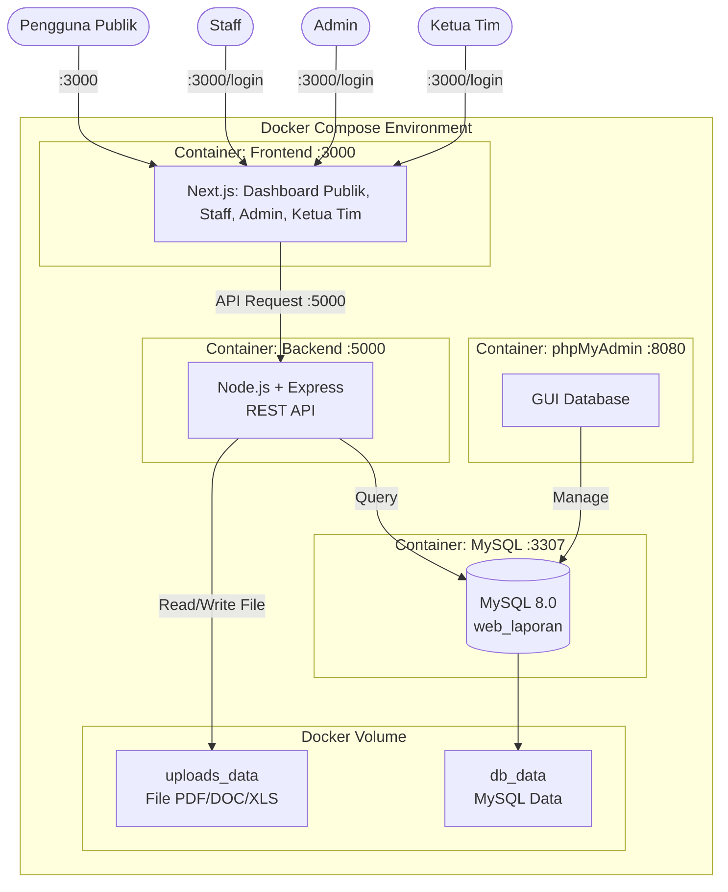
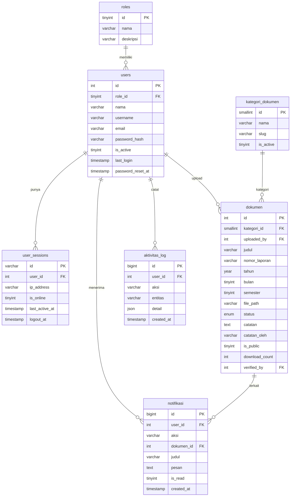

# Web Dashboard Laporan

Sistem dashboard untuk menampilkan, mengelola, dan mengunduh dokumen laporan instansi pemerintah. Publik dapat mengunduh dokumen tanpa login, staff dapat upload dan mengajukan verifikasi, admin menyaring dokumen di tahap pertama, dan ketua tim memberikan persetujuan final untuk publikasi.

---

## Stack Teknologi

| Bagian | Teknologi |
|---|---|
| Frontend | Next.js 14 + TypeScript + Tailwind CSS |
| Backend | Node.js + Express.js |
| Database | MySQL 8.0 |
| Auth | JWT + bcrypt |
| Infrastructure | Docker + Docker Compose |

---

## Fitur

### Dashboard Publik
- Daftar dokumen terverifikasi dengan filter kategori, tahun, dan pencarian (juga mencocokkan nomor laporan)
- Download dokumen langsung tanpa login
- Halaman detail dokumen
- Statistik total dokumen, kategori, dan unduhan

### Dashboard Staff
- Upload dokumen dengan drag & drop (maks **50MB**)
- Pilih periode laporan: **Bulan** ATAU **Semester** (tidak bisa keduanya)
- Nomor laporan otomatis ter-generate (format `{KATEGORI}/{TAHUN}/{ID}`, contoh `LKJIP/2024/001`)
- Edit metadata dokumen (judul, kategori, tahun, periode, deskripsi)
- **Ganti file dokumen saat status draft atau revisi** (tanpa hapus dan upload ulang)
- Submit dokumen untuk verifikasi
- Lihat status dokumen (termasuk "Menunggu Admin" dan "Menunggu Ketua Tim") dan catatan revisi beserta siapa yang memberi catatan
- Ganti password dan kelola profil
- **Lupa Password via Email** menggunakan integrasi Brevo API
- Tombol kembali ke beranda publik

### Dashboard Admin
- Statistik realtime (total dokumen, menunggu verifikasi, user online)
- **Penyaring pertama verifikasi**: tinjau dokumen dengan preview PDF langsung di modal
- **"Loloskan ke Ketua Tim"** (status `lolos_admin`) atau **"Kembalikan Revisi"** dengan catatan
- Monitoring user online realtime (auto refresh 30 detik)
- Manajemen user — tambah, aktifkan/nonaktifkan, hapus
- **Kelola kategori dokumen** — tambah, edit, hapus, aktif/nonaktif dari dashboard
- Log aktivitas sistem dengan pagination dan hapus riwayat
- Hapus dokumen beserta file fisiknya
- **Fitur Perbandingan Nominal**: membandingkan dua laporan untuk melihat deviasi (khusus untuk dokumen tertentu)
- Tombol kembali ke beranda publik

### Dashboard Ketua Tim
- **Persetujuan final dokumen** — panel "Menunggu Persetujuan Saya" berisi dokumen `lolos_admin`
- **"Setujui & Publish"** (tampil di publik) atau **"Kembalikan Revisi"** dengan catatan wajib
- Dashboard grafik realtime (auto refresh 30 detik): jumlah dokumen per staff, trend upload 14 hari, distribusi status dokumen, dan daftar user online
- Monitor semua dokumen (siapa upload, status, kategori, tanggal)
- Lihat semua user admin & staff beserta status online dan riwayat reset password
- Aktifkan/nonaktifkan akun admin & staff yang sudah tidak bekerja
- Reset password user — password baru di-generate otomatis dan **hanya ditampilkan sekali**, riwayat waktu reset tercatat
- Kirim notifikasi manual: pengumuman ke semua user (broadcast) atau pesan ke satu user tertentu
- Lihat log aktivitas seluruh sistem dengan pagination
- Guard keamanan: admin tidak bisa menonaktifkan/menghapus ketua tim, ketua tim tidak bisa mengubah sesama ketua tim
- **Fitur Perbandingan Nominal**: menganalisis perbedaan nominal antar dua dokumen laporan.

---

## Proses Bisnis

Sistem ini mengelola siklus hidup dokumen laporan instansi — mulai dari pembuatan laporan oleh staff sampai dipublikasikan ke masyarakat — dengan **verifikasi berjenjang dua tahap** untuk menjamin tidak ada dokumen yang terbit tanpa melalui penyaringan Admin dan persetujuan final Ketua Tim.

### Pelaku & Tanggung Jawab

| Pelaku | Tanggung Jawab dalam Proses Bisnis |
|---|---|
| **Staff** | Menyusun laporan, mengupload dokumen, melengkapi metadata (kategori, tahun, bulan/semester), mengajukan verifikasi, dan memperbaiki dokumen berdasarkan catatan revisi |
| **Admin** | Penyaring pertama — meninjau isi dokumen (preview PDF), meloloskan dokumen layak ke Ketua Tim atau mengembalikannya ke staff dengan catatan revisi; mengelola user, kategori, dan operasional sistem |
| **Ketua Tim** | Pemegang otoritas final — meninjau dokumen yang lolos Admin lalu menyetujui untuk dipublikasikan atau mengembalikan untuk revisi; mengawasi kinerja lewat grafik realtime dan mengelola akun |
| **Publik** | Mencari, melihat detail, dan mengunduh dokumen yang sudah terverifikasi — tanpa perlu login |

### Alur Utama (End-to-End)

| Tahap | Pelaku | Aksi | Hasil / Status Dokumen |
|---|---|---|---|
| 1 | Staff | Upload file laporan (PDF/Word/Excel, maks 50MB) + isi metadata | `draft` — nomor laporan otomatis ter-generate (`{KATEGORI}/{TAHUN}/{ID}`) |
| 2 | Staff | Submit dokumen untuk verifikasi | `menunggu_verifikasi` — Admin menerima notifikasi |
| 3 | Admin | Tinjau isi dokumen lewat preview PDF di modal | — |
| 4a | Admin | **Loloskan** | `lolos_admin` — masuk antrian Ketua Tim + notifikasi |
| 4b | Admin | **Kembalikan Revisi** + catatan | `revisi` — staff menerima notifikasi berisi catatan (tercantum dari Admin) |
| 5 | Ketua Tim | Tinjau dokumen di panel "Menunggu Persetujuan Saya" (preview PDF) | — |
| 6a | Ketua Tim | **Setujui & Publish** | `terverifikasi` — langsung tampil di dashboard publik |
| 6b | Ketua Tim | **Kembalikan Revisi** + catatan wajib | `revisi` — staff menerima notifikasi berisi catatan (tercantum dari Ketua Tim) |
| 7 | Publik | Cari dokumen (filter kategori/tahun atau nomor laporan) lalu download | `download_count` bertambah |

### Loop Revisi

Dokumen yang dikembalikan (tahap 4b atau 6b) kembali ke staff. Staff membaca catatan revisi — lengkap dengan informasi **siapa yang memberi catatan** (Admin atau Ketua Tim) — lalu memperbaiki metadata dan/atau mengganti file, kemudian submit ulang. Dokumen masuk lagi ke tahap penyaringan Admin dari awal. Loop ini berulang sampai dokumen lolos kedua tahap.



### Proses Pendukung

| Proses | Pelaku | Keterangan |
|---|---|---|
| Manajemen akun | Admin & Ketua Tim | Tambah/nonaktifkan/hapus user; Ketua Tim bisa reset password (password baru tampil sekali + riwayat reset tercatat) |
| Lupa password | Staff/Admin | Hubungi Ketua Tim/Admin untuk reset password (halaman `/forgot-password` berisi instruksi) |
| Pengelolaan kategori | Admin | Tambah/edit/hapus/aktif-nonaktif kategori laporan dari dashboard |
| Monitoring & evaluasi | Ketua Tim | Grafik realtime 30 detik: produktivitas per staff, trend upload 14 hari, distribusi status dokumen |
| Komunikasi internal | Ketua Tim | Kirim pengumuman broadcast ke semua user atau pesan ke user tertentu |
| Audit trail | Sistem | Semua aksi tercatat di log aktivitas (dilihat Admin & Ketua Tim) + notifikasi in-app di setiap tahap verifikasi |

### Aturan Bisnis

1. Dokumen **hanya bisa diupload oleh staff** dan baru tampil di publik setelah lolos **dua tahap** verifikasi.
2. Admin **tidak bisa mempublikasikan** dokumen — kewenangannya hanya meloloskan ke Ketua Tim atau mengembalikan revisi.
3. Catatan revisi **wajib diisi** saat mengembalikan dokumen; staff selalu tahu siapa pemberi catatnya (`catatan_oleh`).
4. Nomor laporan bersifat **unik dan otomatis** — tidak bisa diatur manual, menjamin konsistensi kode tracking.
5. Periode laporan diisi **Bulan ATAU Semester** (Sem 1 = Jan–Jun, Sem 2 = Jul–Des), tidak bisa keduanya.
6. File maksimal **50MB** dengan format PDF/DOC/DOCX/XLS/XLSX.
7. Akun yang dinonaktifkan tidak bisa login; ketua tim dilindungi guard — tidak bisa dinonaktifkan/diubah oleh admin maupun sesama ketua tim.

---

## Cara Menjalankan

### Syarat
- Docker Desktop terinstall dan running

### Langkah

```bash
# 1. Clone repository
git clone https://github.com/username/web-dashboard-laporan.git
cd web-dashboard-laporan

# 2. Salin file env
cp .env.example .env
# Edit .env — isi password sesuai kebutuhan

# 3. Jalankan semua container
docker-compose up -d

# 4. Cek status container
docker-compose ps
```

### Rebuild setelah ada perubahan kode

```bash
docker-compose up -d --build
```

### Matikan web

```bash
docker-compose down
```

### URL Akses

| Halaman | URL |
|---|---|
| Dashboard Publik | http://localhost:3000 |
| Login | http://localhost:3000/login |
| Dashboard Staff | http://localhost:3000/staff/dokumen |
| Dashboard Admin | http://localhost:3000/admin |
| Dashboard Ketua Tim | http://localhost:3000/ketua |
| API Health Check | http://localhost:5000/api/health |

### Akun Default

> Lihat file `DOCS.md` untuk informasi akun — tidak dipublikasikan di sini.

---

## Struktur Database

### Tabel

| Tabel | Fungsi |
|---|---|
| `roles` | Daftar role: admin, staff, ketua_tim |
| `users` | Data semua user (admin, staff, ketua tim) |
| `user_sessions` | Tracking session login — untuk monitoring online |
| `kategori_dokumen` | Kategori laporan: LKjIP, Renstra, Renja, RKT, PK, LAKIP, IKU, Lainnya |
| `dokumen` | Data utama laporan + status alur verifikasi 2 tahap + `nomor_laporan`, `bulan`/`semester`, `catatan_oleh` |
| `aktivitas_log` | Log semua aksi user di sistem |
| `notifikasi` | Notifikasi in-app (submit, lolos, approve, reject, pesan ketua tim, reset password) |

### Status Dokumen

| Status | Keterangan |
|---|---|
| `draft` | Baru diupload, belum diajukan |
| `menunggu_verifikasi` | Sudah disubmit staff, menunggu tinjauan Admin |
| `lolos_admin` | Lolos tinjauan Admin, menunggu persetujuan final Ketua Tim |
| `terverifikasi` | Disetujui Ketua Tim, tampil di publik |
| `revisi` | Dikembalikan Admin/Ketua Tim, staff perlu perbaiki |
| `diarsipkan` | Diarsipkan, tidak tampil di publik |

### Kategori Dokumen Default

| Nama | Slug | Urutan |
|---|---|---|
| LKjIP | `lkjip` | 1 |
| Renstra | `renstra` | 2 |
| Renja | `renja` | 3 |
| RKT | `rkt` | 4 |
| PK | `pk` | 5 |
| LAKIP | `lakip` | 6 |
| IKU | `iku` | 7 |
| Lainnya | `lainnya` | 99 |

> Kategori bisa ditambah/diedit/dihapus langsung dari dashboard admin di menu **Kelola Kategori**

---

## Konfigurasi .env

Salin `.env.example` menjadi `.env` lalu sesuaikan nilainya.

```bash
cp .env.example .env
```

Tambahkan variable berikut ke file `.env` untuk mengaktifkan fitur email:
```env
BREVO_API_KEY=xkeysib-kodeapikamu
EMAIL_FROM=no-reply@laporan.go.id
```

> Detail konfigurasi ada di file `.env.example` — jangan commit file `.env` ke GitHub.

---

## Ketentuan Upload File

| Item | Nilai |
|---|---|
| Format yang didukung | PDF, DOC, DOCX, XLS, XLSX |
| Ukuran maksimal | 50 MB per file |
| Penyimpanan | Docker Volume (uploads_data) |

---

## Alur Status Dokumen



---

## DFD Level 0 — Context Diagram



---

## DFD Level 1 — Detail Proses



---

## Flowchart — Alur Sistem Lengkap



---

## Activity Diagram — Upload & Verifikasi Dokumen



---

## Activity Diagram — Monitoring Admin



---

## Activity Diagram — Monitoring Ketua Tim



---

## Workflow — Docker & Arsitektur Sistem



---

## Struktur Database



---

## API Endpoints

### Auth
| Method | Endpoint | Akses |
|---|---|---|
| POST | `/api/auth/login` | Publik |
| POST | `/api/auth/logout` | Publik |
| GET | `/api/auth/me` | Login |

### Dokumen
| Method | Endpoint | Akses |
|---|---|---|
| GET | `/api/dokumen` | Publik |
| GET | `/api/dokumen/kategori` | Publik |
| GET | `/api/dokumen/:id` | Publik |
| GET | `/api/dokumen/:id/download` | Publik |
| GET | `/api/dokumen/all` | Staff/Admin |
| POST | `/api/dokumen/upload` | Staff/Admin |
| PATCH | `/api/dokumen/:id` | Staff/Admin |
| PATCH | `/api/dokumen/:id/submit` | Staff |
| PATCH | `/api/dokumen/:id/file` | Staff/Admin |
| GET | `/api/dokumen/:id/preview` | Admin |
| PATCH | `/api/dokumen/:id/verify` | Admin — aksi `lolos` / `reject` (penyaring 1) |
| PATCH | `/api/dokumen/:id/ketua-verify` | Ketua Tim — aksi `approve` / `reject` (persetujuan final) |
| DELETE | `/api/dokumen/:id` | Admin |

### Admin
| Method | Endpoint | Akses |
|---|---|---|
| GET | `/api/admin/stats` | Admin |
| GET | `/api/admin/users` | Admin |
| GET | `/api/admin/users/online` | Admin |
| POST | `/api/admin/users` | Admin |
| PATCH | `/api/admin/users/:id/toggle` | Admin |
| DELETE | `/api/admin/users/:id` | Admin |
| GET | `/api/admin/logs` | Admin |
| DELETE | `/api/admin/logs?before_days=30` | Admin |
| GET | `/api/admin/kategori` | Admin |
| POST | `/api/admin/kategori` | Admin |
| PATCH | `/api/admin/kategori/:id` | Admin |
| DELETE | `/api/admin/kategori/:id` | Admin |

### User
| Method | Endpoint | Akses |
|---|---|---|
| GET | `/api/user/profile` | Login |
| PATCH | `/api/user/profile` | Login |
| PATCH | `/api/user/password` | Login |

### Ketua Tim
| Method | Endpoint | Akses |
|---|---|---|
| GET | `/api/ketua/stats` | Ketua Tim |
| GET | `/api/ketua/users` | Ketua Tim |
| GET | `/api/ketua/users/online` | Ketua Tim |
| PATCH | `/api/ketua/users/:id/toggle` | Ketua Tim |
| POST | `/api/ketua/users/:id/reset-password` | Ketua Tim |
| GET | `/api/ketua/dokumen` | Ketua Tim |
| GET | `/api/ketua/dokumen/menunggu` | Ketua Tim — antrian `lolos_admin` |
| GET | `/api/ketua/logs` | Ketua Tim |
| POST | `/api/ketua/notifikasi/kirim` | Ketua Tim |

---

## Changelog

### v1.1.0 — 17 Agustus 2026

| Perubahan | File yang Diubah |
|---|---|
| Batas upload diperkecil dari 500MB → **100MB** per file | `backend/src/config/multer.js`, `backend/src/index.js`, `backend/src/middleware/errorHandler.js` |
| Label dan validasi upload disesuaikan ke 100MB | `frontend/src/app/staff/dokumen/upload/page.tsx`, `frontend/src/app/staff/dokumen/[id]/edit/page.tsx` |
| Dokumentasi diperbarui (README, DOCS, TASKS) | `README.md`, `DOCS.md`, `TASKS.md` |

### v1.2.0 — 17 Agustus 2026

| Perubahan | File yang Diubah |
|---|---|
| **Fitur baru: Sistem Notifikasi In-App** — bell icon + badge + dropdown | `frontend/src/components/ui/NotificationBell.tsx` |
| Tabel `notifikasi` baru di database | `database/init/01_schema.sql`, `database/init/03_notifikasi.sql` |
| API endpoint notifikasi (list, unread-count, mark read, mark all) | `backend/src/controllers/notifikasiController.js`, `backend/src/routes/notifikasi.js` |
| Notifikasi otomatis saat submit → admin, approve/reject → staff | `backend/src/controllers/dokumenController.js`, `backend/src/index.js` |
| Bell icon ditambahkan ke layout staff & admin | `frontend/src/app/staff/layout.tsx`, `frontend/src/app/admin/layout.tsx` |

### v1.3.0 — 17 Agustus 2026

| Perubahan | File yang Diubah |
|---|---|
| **Fitur baru: Idle Auto Logout** — logout otomatis setelah 30 menit idle | `frontend/src/hooks/useIdleTimeout.ts` |
| Warning modal dengan countdown 2 menit sebelum logout paksa | `frontend/src/components/ui/SessionTimeoutModal.tsx` |
| Hook idle timeout diintegrasikan ke layout staff & admin | `frontend/src/app/staff/layout.tsx`, `frontend/src/app/admin/layout.tsx` |

### v1.4.0 — 17 Agustus 2026

| Perubahan | File yang Diubah |
|---|---|
| **Fitur baru: Role Ketua Tim** (`ketua_tim`) dengan dashboard terpisah `/ketua` | `database/init/02_seed.sql`, `backend/src/middleware/auth.js` |
| Dashboard ketim dengan grafik realtime (recharts): upload per staff, trend 14 hari, distribusi status, user online | `frontend/src/app/ketua/page.tsx`, `frontend/package.json` |
| Manajemen user: aktif/nonaktif admin & staff + reset password (password tampil sekali, riwayat reset tersimpan) | `frontend/src/app/ketua/users/page.tsx`, `backend/src/controllers/ketuaController.js` |
| Monitor dokumen read-only + log aktivitas | `frontend/src/app/ketua/dokumen/page.tsx`, `frontend/src/app/ketua/logs/page.tsx` |
| Kirim notifikasi manual (broadcast semua user / per divisi / satu user) | `frontend/src/app/ketua/kirim-notifikasi/page.tsx` |
| Guard: admin tidak bisa nonaktifkan/hapus ketua tim; ketim tidak bisa ubah sesama ketim | `backend/src/controllers/adminController.js`, `backend/src/controllers/ketuaController.js` |
| API endpoint baru `/api/ketua/*` + kolom `password_reset_at` | `backend/src/routes/ketua.js`, `backend/src/index.js`, `database/init/04_ketua_tim.sql` |
| Sidebar ketua tim + update role-aware di navbar, auth context, dan hook | `frontend/src/components/ketua/KetuaSidebar.tsx`, `frontend/src/components/layout/Navbar.tsx`, `frontend/src/context/AuthContext.tsx`, `frontend/src/hooks/useRequireAuth.ts` |

### v1.5.1 — Notifikasi Ketim per Divisi ❌ (dihapus di v2.0.0)

| Perubahan | File yang Diubah |
|---|---|
| Mode target baru `'divisi'` + `divisi_id` di kirim notifikasi: kirim ke semua user aktif satu divisi (staff + admin divisi), error jelas bila divisi tanpa user aktif, log & response mencantumkan nama divisi | `backend/src/controllers/ketuaController.js` |
| Tombol tujuan jadi 3 (Semua User / Divisi Tertentu / Satu User) + dropdown divisi dari endpoint publik + label konfirmasi menyebut nama divisi | `frontend/src/app/ketua/kirim-notifikasi/page.tsx` |

### v1.5.0 — Sistem Divisi & Admin Divisi ❌ (dihapus total di v2.0.0)

| Perubahan | File yang Diubah |
|---|---|
| **Fitur baru: Sistem Divisi** — master data divisi + kolom `divisi_id` di users & dokumen, dokumen otomatis mewarisi divisi uploader | `database/init/05_divisi.sql`, `database/init/01_schema.sql`, `database/init/02_seed.sql` |
| **Fitur baru: Role `admin_dept`** (id 4) — pakai dashboard `/admin` & API `/api/admin/*` yang sama, semua data ter-scope ke divisinya + guard 403 lintas divisi | `backend/src/middleware/auth.js`, `backend/src/controllers/adminController.js`, `backend/src/controllers/dokumenController.js`, `backend/src/routes/admin.js` |
| CRUD divisi (admin global) + endpoint publik daftar divisi aktif | `backend/src/controllers/divisiController.js`, `backend/src/routes/dokumen.js` |
| Ketua tim tetap global + dropdown filter divisi untuk drill-down grafik & dokumen | `backend/src/controllers/ketuaController.js`, `frontend/src/app/ketua/page.tsx`, `frontend/src/app/ketua/dokumen/page.tsx` |
| Halaman baru Kelola Divisi + kolom/filter divisi di admin dokumen & users | `frontend/src/app/admin/divisi/page.tsx`, `frontend/src/app/admin/dokumen/page.tsx`, `frontend/src/app/admin/users/page.tsx` |
| Filter divisi di halaman publik + badge divisi di card dokumen | `frontend/src/components/ui/FilterBar.tsx`, `frontend/src/components/ui/DokumenCard.tsx`, `frontend/src/app/page.tsx` |
| Akun contoh: `dept_keuangan` / `Dept@123` (Admin Divisi Keuangan) | `database/init/05_divisi.sql`, `DOCS.md` |

### v2.0.0 — 20 Agustus 2026 (Refactoring Besar: Revisi Mentor & Ketua Tim)

| Perubahan | File yang Diubah |
|---|---|
| **Verifikasi 2 tahap**: Admin loloskan (`lolos_admin`) → Ketua Tim setujui/publish (`terverifikasi`); status baru `lolos_admin` di ENUM | `database/init/01_schema.sql`, `database/migration_v2.sql`, `backend/src/controllers/dokumenController.js`, `backend/src/routes/dokumen.js` |
| Endpoint baru `PATCH /api/dokumen/:id/ketua-verify` + `GET /api/ketua/dokumen/menunggu` | `backend/src/routes/dokumen.js`, `backend/src/routes/ketua.js`, `backend/src/controllers/ketuaController.js` |
| **Hapus total sistem divisi & role `admin_dept`** — tabel `divisi`, kolom `divisi_id`, halaman `/admin/divisi`, filter divisi publik/ketua, endpoint `/api/admin/divisi` | seluruh backend + frontend + schema/seed |
| **Kode tracking `nomor_laporan`** (`{KATEGORI}/{TAHUN}/{ID}`) — auto-generate saat upload + bisa dicari di halaman publik | `backend/src/controllers/dokumenController.js`, schema/seed |
| **Field `semester`** (Sem 1 = Jan–Jun, Sem 2 = Jul–Des) — pilihan eksklusif dengan bulan di form upload & edit | `frontend/src/app/staff/dokumen/upload/page.tsx`, `frontend/src/app/staff/dokumen/[id]/edit/page.tsx` |
| **Kolom `catatan_oleh`** — catatan revisi tampil beserta siapa yang memberi (Admin/Ketua Tim) | `database/migration_v2.sql`, `backend/src/controllers/dokumenController.js`, halaman staff |
| **Batas upload 100MB → 50MB** | `backend/src/config/multer.js`, `backend/src/middleware/errorHandler.js`, `backend/src/index.js`, form upload & edit |
| **Halaman `/forgot-password`** — instruksi hubungi Admin/Ketua Tim (belum ada email) | `frontend/src/app/forgot-password/page.tsx`, `frontend/src/app/login/page.tsx` |
| UI Ketua Tim: panel "Menunggu Persetujuan Saya" + tombol Setujui & Publish / Kembalikan Revisi; UI Admin: Loloskan ke Ketua Tim / Kembalikan Revisi | `frontend/src/app/ketua/dokumen/page.tsx`, `frontend/src/app/admin/dokumen/page.tsx` |
| **Preview dokumen untuk Ketua Tim** — tombol Tinjau + modal preview PDF (streaming dengan progress bar) di antrian persetujuan; fix header CORS invalid di endpoint preview | `frontend/src/app/ketua/dokumen/page.tsx`, `frontend/src/app/admin/dokumen/page.tsx`, `backend/src/controllers/dokumenController.js` |
| Dokumentasi **Proses Bisnis** (pelaku & tanggung jawab, alur end-to-end, loop revisi, proses pendukung, aturan bisnis) | `README.md` |

### v2.2.0 — 02 September 2026

| Perubahan | File yang Diubah |
|---|---|
| **Fitur baru: Lupa Password via Email** — integrasi API Brevo via HTTPS request (solusi atas blokir SMTP port di Railway), fitur rate limiter 3 request/jam | `backend/src/controllers/authController.js`, `frontend/src/app/reset-password/page.tsx`, `backend/src/routes/auth.js` |
| **Fitur baru: Perbandingan Nominal** — fitur bagi admin dan ketua tim untuk membandingkan nominal antar dokumen | (Berbagai komponen terkait fitur perbandingan) |
| **Perbaikan UI Navigasi Auth** — penghapusan tombol Dashboard Publik yang membingungkan dan mengganti tulisan menjadi tombol Kembali | `frontend/src/app/login/layout.tsx`, `frontend/src/app/login/page.tsx` |

> Catatan: poin revisi "Kategori → Akun" belum dikerjakan — menunggu keputusan final mentor.

---

## Kontributor

- **Naufal Adiva Putra Lisna** — Developer (Magang)

