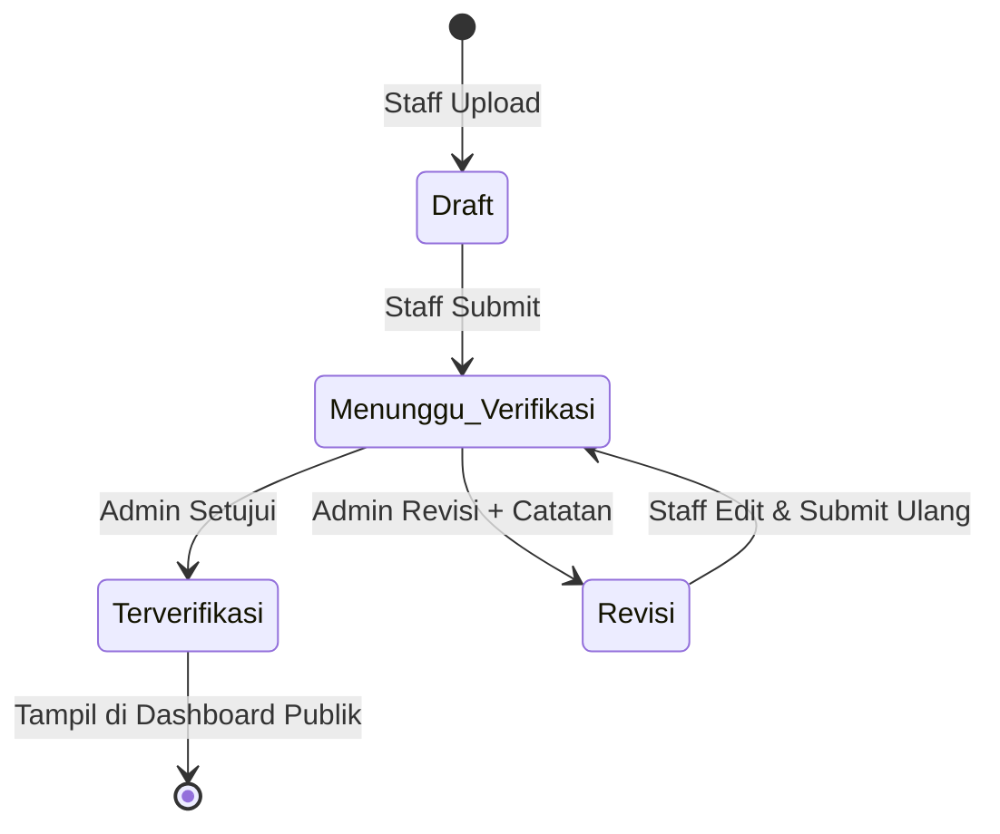
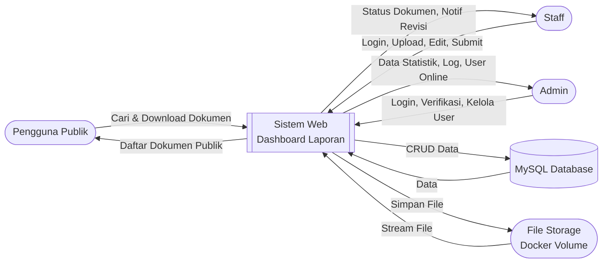
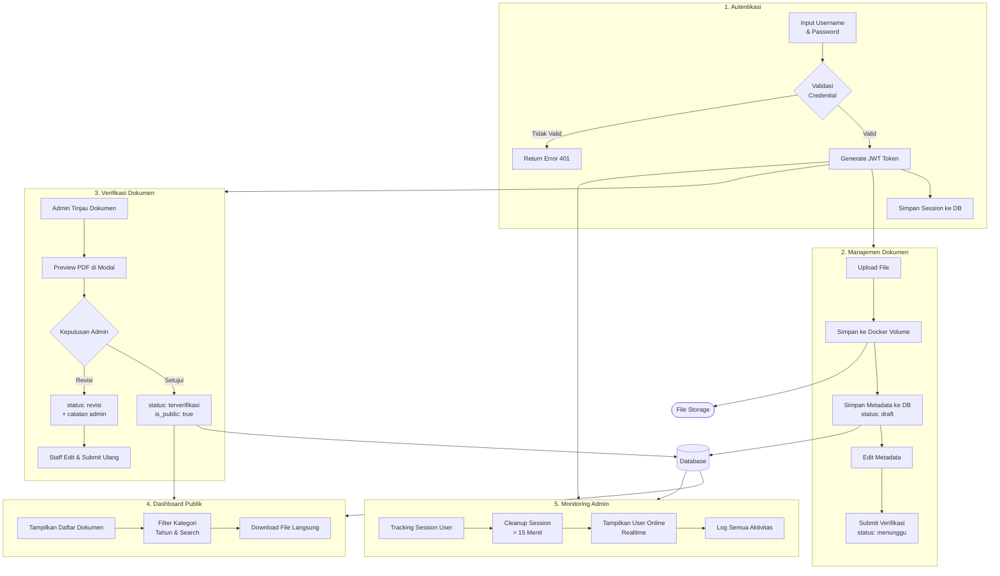
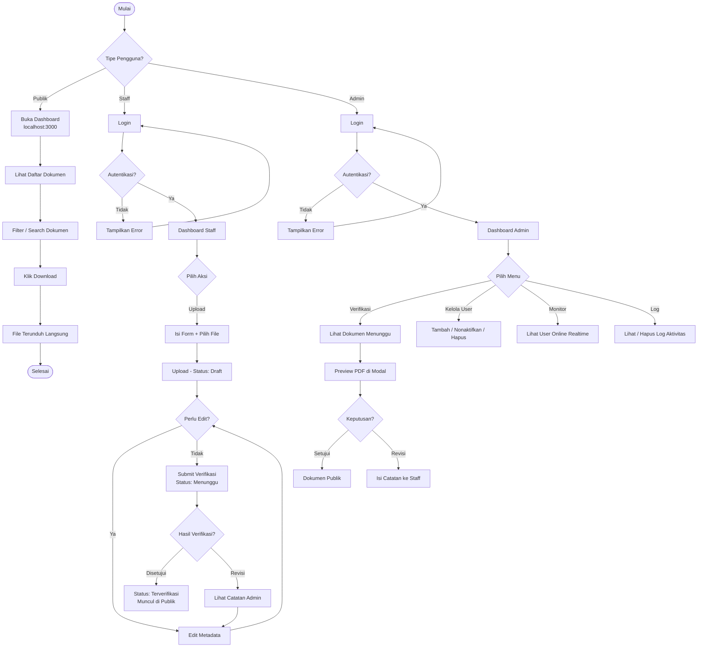
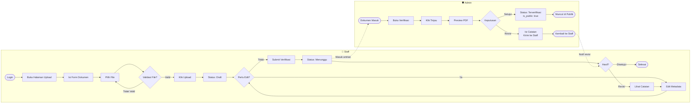
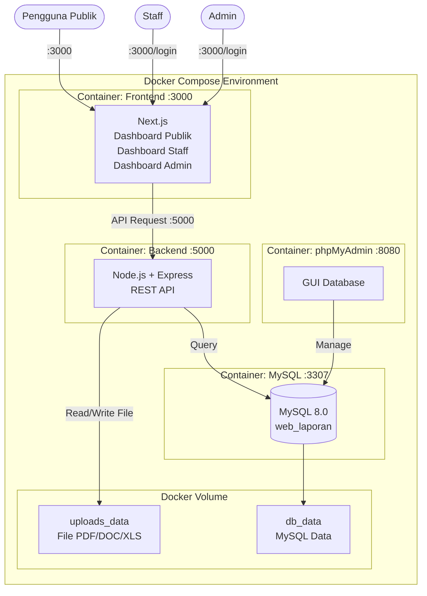
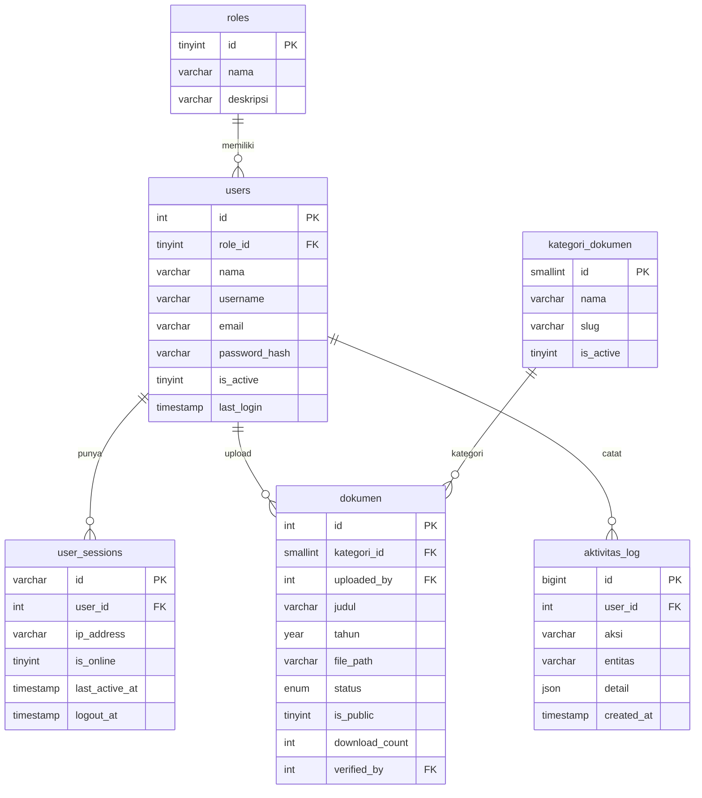

# Web Dashboard Laporan

Sistem dashboard untuk menampilkan, mengelola, dan mengunduh dokumen laporan instansi. Publik dapat mengunduh dokumen tanpa login, staff dapat upload dan mengajukan verifikasi, admin dapat menyetujui dan memantau aktivitas.

---

## Stack Teknologi

| Bagian | Teknologi |
|---|---|
| Frontend | Next.js 14 + TypeScript + Tailwind CSS |
| Backend | Node.js + Express.js |
| Database | MySQL 8.0 |
| Auth | JWT + bcrypt |
| Infrastructure | Docker + Docker Compose |

---

## Fitur

### Dashboard Publik
- Daftar dokumen terverifikasi dengan filter kategori, tahun, dan pencarian
- Download dokumen langsung tanpa login
- Halaman detail dokumen
- Statistik total dokumen, kategori, dan unduhan

### Dashboard Staff
- Upload dokumen dengan drag & drop (maks 100MB)
- Edit metadata dokumen (judul, kategori, tahun, deskripsi)
- **Ganti file dokumen saat status draft atau revisi** (tanpa hapus dan upload ulang)
- Submit dokumen untuk verifikasi
- Lihat status dokumen dan catatan revisi dari admin
- Ganti password dan kelola profil
- Tombol kembali ke beranda publik

### Dashboard Admin
- Statistik realtime (total dokumen, menunggu verifikasi, user online)
- Verifikasi dokumen dengan preview PDF langsung di modal
- Setujui atau kembalikan dokumen untuk revisi dengan catatan
- Monitoring user online realtime (auto refresh 30 detik)
- Manajemen user — tambah, aktifkan/nonaktifkan, hapus
- **Kelola kategori dokumen** — tambah, edit, hapus, aktif/nonaktif dari dashboard
- Log aktivitas sistem dengan pagination dan hapus riwayat
- Hapus dokumen beserta file fisiknya
- Tombol kembali ke beranda publik

---

## Cara Menjalankan

### Syarat
- Docker Desktop terinstall dan running

### Langkah

```bash
# 1. Clone repository
git clone https://github.com/username/web-dashboard-laporan.git
cd web-dashboard-laporan

# 2. Salin file env
cp .env.example .env
# Edit .env — isi password sesuai kebutuhan

# 3. Jalankan semua container
docker-compose up -d

# 4. Cek status container
docker-compose ps
```

### Rebuild setelah ada perubahan kode

```bash
docker-compose up -d --build
```

### Matikan web

```bash
docker-compose down
```

### URL Akses

| Halaman | URL |
|---|---|
| Dashboard Publik | http://localhost:3000 |
| Login | http://localhost:3000/login |
| Dashboard Staff | http://localhost:3000/staff/dokumen |
| Dashboard Admin | http://localhost:3000/admin |
| API Health Check | http://localhost:5000/api/health |

### Akun Default

> Lihat file `DOCS.md` untuk informasi akun — tidak dipublikasikan di sini.

---

## Struktur Database

### Tabel

| Tabel | Fungsi |
|---|---|
| `roles` | Daftar role: admin, staff, ketua_tim |
| `users` | Data semua user (admin & staff) |
| `user_sessions` | Tracking session login — untuk monitoring online |
| `kategori_dokumen` | Kategori laporan: LKjIP, Renstra, Renja, RKT, PK, LAKIP, IKU, Lainnya |
| `dokumen` | Data utama laporan + status alur verifikasi |
| `aktivitas_log` | Log semua aksi user di sistem |

### Status Dokumen

| Status | Keterangan |
|---|---|
| `draft` | Baru diupload, belum diajukan |
| `menunggu_verifikasi` | Sudah disubmit staff, menunggu admin |
| `terverifikasi` | Disetujui admin, tampil di publik |
| `revisi` | Dikembalikan admin, staff perlu perbaiki |
| `diarsipkan` | Diarsipkan, tidak tampil di publik |

### Kategori Dokumen Default

| Nama | Slug | Urutan |
|---|---|---|
| LKjIP | `lkjip` | 1 |
| Renstra | `renstra` | 2 |
| Renja | `renja` | 3 |
| RKT | `rkt` | 4 |
| PK | `pk` | 5 |
| LAKIP | `lakip` | 6 |
| IKU | `iku` | 7 |
| Lainnya | `lainnya` | 99 |

> Kategori bisa ditambah/diedit/dihapus langsung dari dashboard admin di menu **Kelola Kategori**

---

## Struktur Folder

```
web-dashboard-laporan/
├── docker-compose.yml
├── .env.example
├── .gitignore
├── README.md
├── database/
│   └── init/
│       ├── 01_schema.sql     ← struktur tabel
│       └── 02_seed.sql       ← data awal
├── backend/
│   ├── Dockerfile
│   ├── package.json
│   └── src/
│       ├── index.js
│       ├── config/           ← db.js, multer.js
│       ├── controllers/      ← auth, dokumen, user, admin
│       ├── middleware/       ← auth JWT, validate, logger, error
│       └── routes/           ← auth, dokumen, user, admin
└── frontend/
    ├── Dockerfile
    ├── package.json
    ├── next.config.js
    ├── tailwind.config.ts
    └── src/
        ├── app/
        │   ├── page.tsx              ← dashboard publik
        │   ├── login/
        │   ├── dokumen/[id]/
        │   ├── staff/                ← dokumen, upload, edit, profil
        │   └── admin/                ← dashboard, dokumen, kategori, users, logs
        ├── components/
        │   ├── layout/               ← Navbar, Footer
        │   ├── ui/                   ← DokumenCard, FilterBar, Pagination
        │   ├── staff/                ← Sidebar
        │   └── admin/                ← AdminSidebar
        ├── context/                  ← AuthContext
        ├── hooks/                    ← useRequireAuth
        └── lib/                      ← api.ts, auth.ts, dateUtils.ts
```

---

## Konfigurasi .env

Salin `.env.example` menjadi `.env` lalu sesuaikan nilainya.

```bash
cp .env.example .env
```

> Detail konfigurasi ada di file `.env.example` — jangan commit file `.env` ke GitHub.

---

## Ketentuan Upload File

| Item | Nilai |
|---|---|
| Format yang didukung | PDF, DOC, DOCX, XLS, XLSX |
| Ukuran maksimal | 100 MB per file |
| Penyimpanan | Docker Volume (uploads_data) |

---

## Alur Status Dokumen



---

## DFD Level 0 — Context Diagram



---

## DFD Level 1 — Detail Proses



---

## Flowchart — Alur Sistem Lengkap



---

## Activity Diagram — Upload & Verifikasi Dokumen



---

## Activity Diagram — Monitoring Admin


---

## Workflow — Docker & Arsitektur Sistem



---

## Struktur Database



---

## API Endpoints

### Auth
| Method | Endpoint | Akses |
|---|---|---|
| POST | `/api/auth/login` | Publik |
| POST | `/api/auth/logout` | Publik |
| GET | `/api/auth/me` | Login |

### Dokumen
| Method | Endpoint | Akses |
|---|---|---|
| GET | `/api/dokumen` | Publik |
| GET | `/api/dokumen/kategori` | Publik |
| GET | `/api/dokumen/:id` | Publik |
| GET | `/api/dokumen/:id/download` | Publik |
| GET | `/api/dokumen/all` | Staff/Admin |
| POST | `/api/dokumen/upload` | Staff/Admin |
| PATCH | `/api/dokumen/:id` | Staff/Admin |
| PATCH | `/api/dokumen/:id/submit` | Staff |
| PATCH | `/api/dokumen/:id/file` | Staff/Admin |
| GET | `/api/dokumen/:id/preview` | Admin |
| PATCH | `/api/dokumen/:id/verify` | Admin |
| DELETE | `/api/dokumen/:id` | Admin |

### Admin
| Method | Endpoint | Akses |
|---|---|---|
| GET | `/api/admin/stats` | Admin |
| GET | `/api/admin/users` | Admin |
| GET | `/api/admin/users/online` | Admin |
| POST | `/api/admin/users` | Admin |
| PATCH | `/api/admin/users/:id/toggle` | Admin |
| DELETE | `/api/admin/users/:id` | Admin |
| GET | `/api/admin/logs` | Admin |
| DELETE | `/api/admin/logs?before_days=30` | Admin |
| GET | `/api/admin/kategori` | Admin |
| POST | `/api/admin/kategori` | Admin |
| PATCH | `/api/admin/kategori/:id` | Admin |
| DELETE | `/api/admin/kategori/:id` | Admin |

### User
| Method | Endpoint | Akses |
|---|---|---|
| GET | `/api/user/profile` | Login |
| PATCH | `/api/user/profile` | Login |
| PATCH | `/api/user/password` | Login |

### Ketua Tim
| Method | Endpoint | Akses |
|---|---|---|
| GET | `/api/ketua/stats` | Ketua Tim |
| GET | `/api/ketua/users` | Ketua Tim |
| GET | `/api/ketua/users/online` | Ketua Tim |
| PATCH | `/api/ketua/users/:id/toggle` | Ketua Tim |
| POST | `/api/ketua/users/:id/reset-password` | Ketua Tim |
| GET | `/api/ketua/dokumen` | Ketua Tim |
| GET | `/api/ketua/logs` | Ketua Tim |
| POST | `/api/ketua/notifikasi/kirim` | Ketua Tim |

---

## Changelog

### v1.1.0 — 17 Agustus 2026

| Perubahan | File yang Diubah |
|---|---|
| Batas upload diperkecil dari 500MB → **100MB** per file | `backend/src/config/multer.js`, `backend/src/index.js`, `backend/src/middleware/errorHandler.js` |
| Label dan validasi upload disesuaikan ke 100MB | `frontend/src/app/staff/dokumen/upload/page.tsx`, `frontend/src/app/staff/dokumen/[id]/edit/page.tsx` |
| Dokumentasi diperbarui (README, DOCS, TASKS) | `README.md`, `DOCS.md`, `TASKS.md` |

### v1.2.0 — 17 Agustus 2026

| Perubahan | File yang Diubah |
|---|---|
| **Fitur baru: Sistem Notifikasi In-App** — bell icon + badge + dropdown | `frontend/src/components/ui/NotificationBell.tsx` |
| Tabel `notifikasi` baru di database | `database/init/01_schema.sql`, `database/init/03_notifikasi.sql` |
| API endpoint notifikasi (list, unread-count, mark read, mark all) | `backend/src/controllers/notifikasiController.js`, `backend/src/routes/notifikasi.js` |
| Notifikasi otomatis saat submit → admin, approve/reject → staff | `backend/src/controllers/dokumenController.js`, `backend/src/index.js` |
| Bell icon ditambahkan ke layout staff & admin | `frontend/src/app/staff/layout.tsx`, `frontend/src/app/admin/layout.tsx` |

### v1.3.0 — 17 Agustus 2026

| Perubahan | File yang Diubah |
|---|---|
| **Fitur baru: Idle Auto Logout** — logout otomatis setelah 30 menit idle | `frontend/src/hooks/useIdleTimeout.ts` |
| Warning modal dengan countdown 2 menit sebelum logout paksa | `frontend/src/components/ui/SessionTimeoutModal.tsx` |
| Hook idle timeout diintegrasikan ke layout staff & admin | `frontend/src/app/staff/layout.tsx`, `frontend/src/app/admin/layout.tsx` |

### v1.4.0 — 17 Agustus 2026

| Perubahan | File yang Diubah |
|---|---|
| **Fitur baru: Role Ketua Tim** (`ketua_tim`) dengan dashboard terpisah `/ketua` | `database/init/02_seed.sql`, `backend/src/middleware/auth.js` |
| Dashboard ketim dengan grafik realtime (recharts): upload per staff, trend 14 hari, distribusi status, user online | `frontend/src/app/ketua/page.tsx`, `frontend/package.json` |
| Manajemen user: aktif/nonaktif admin & staff + reset password (password tampil sekali, riwayat reset tersimpan) | `frontend/src/app/ketua/users/page.tsx`, `backend/src/controllers/ketuaController.js` |
| Monitor dokumen read-only + log aktivitas | `frontend/src/app/ketua/dokumen/page.tsx`, `frontend/src/app/ketua/logs/page.tsx` |
| Kirim notifikasi manual (broadcast semua user / satu user) | `frontend/src/app/ketua/kirim-notifikasi/page.tsx` |
| Guard: admin tidak bisa nonaktifkan/hapus ketua tim; ketim tidak bisa ubah sesama ketim | `backend/src/controllers/adminController.js`, `backend/src/controllers/ketuaController.js` |
| API endpoint baru `/api/ketua/*` + kolom `password_reset_at` | `backend/src/routes/ketua.js`, `backend/src/index.js`, `database/init/04_ketua_tim.sql` |
| Sidebar ketua tim + update role-aware di navbar, auth context, dan hook | `frontend/src/components/ketua/KetuaSidebar.tsx`, `frontend/src/components/layout/Navbar.tsx`, `frontend/src/context/AuthContext.tsx`, `frontend/src/hooks/useRequireAuth.ts` |

---

## Kontributor

- **Naufal Adiva Putra Lisna** — Developer (Magang)

