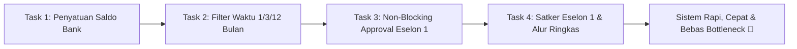

# 📝 Dokumen Task: 4 Revisi Penyempurnaan Sistem Terbaru

Dokumen ini berisi rincian teknis, checklist implementasi, dan alur kerja untuk **4 Poin Revisi Terbaru** pada aplikasi **Web Laporan Keuangan & Rekonsiliasi Kas Satker**.

---

## 📌 Ringkasan 4 Task Utama

| No | Nama Task | Fokus Utama | Target Komponen |
| :-: | :--- | :--- | :--- |
| **1** | **Penyatuan Saldo Akhir Rekening Bank** | Menyatukan *"Saldo Bank"* vs *"Kas Bukti"* menjadi 1 angka tunggal yang jelas | UI Dokumen, Rekening Koran, Form Upload, Modal |
| **2** | **Filter Rentang Waktu Fleksibel** | Menambahkan filter Per Bulan, Per 3 Bulan (Triwulan), dan 1 Tahun | Filter Bar, State Management, Agregasi Total |
| **3** | **Penghapusan Hard-Approval Eselon 1** | Mengubah wewenang Eselon 1 dari *blocking approval* menjadi murni *Monitoring & Audit* | Backend Dokumen, Eselon 1 Router, UI Eselon 1 |
| **4** | **Penyesuaian Peran Ganda Eselon 1 & Alur Satker** | Kantor Eselon 1 juga bisa input sebagai Satker mandiri, serta penyederhanaan alur internal satker | Auth Context, User Roles, Relasi Satker-Eselon 1 |

---

## 🚀 Rincian Detail Setiap Task

### 🔹 TASK 1: Penyatuan "Saldo Bank vs Kas Bukti" Menjadi 1 Angka Tunggal
> **Latar Belakang:**  
> Selama ini staf satker bingung karena ada 2 angka terpisah (*"Saldo Rekening Koran"* vs *"Nilai Excel/Kas Bukti"*), seolah-olah ada 2 jenis kas yang berbeda. Padahal uang kas satker yang sah adalah uang riil yang ada di rekening bank satker tersebut.

- [ ] **1.1. Sederhanakan Field Input & Entity**:
  - Hapus komparasi rumit *"Selisih Kas vs Saldo Bank"* di form upload dan tabel.
  - Jadikan **"Saldo Akhir Rekening Bank"** sebagai satu-satunya angka nominal utama.
- [ ] **1.2. Berkas PDF Sebagai Bukti Sah (*Evidence Voucher*)**:
  - File PDF/Excel rekening koran yang diunggah otomatis menjadi berkas bukti sah yang memverifikasi kebenaran angka saldo akhir tersebut.
- [ ] **1.3. Pembaruan Kartu Ringkasan UI**:
  - Mengubah kartu saldo menjadi:
    - 💳 **Total Saldo Akhir Kas Bank** (Rp X.XXX.XXX)
    - 🏦 **Jumlah Rekening Aktif**
    - 🏛️ **Mitra Perbankan (BRI, BNI, Mandiri, BTN, dll.)**

---

### 🔹 TASK 2: Filter Rentang Waktu Fleksibel (Per Bulan, Per 3 Bulan, 1 Tahun)
> **Latar Belakang:**  
> Siklus pelaporan instansi pemerintah terbagi menjadi 3 kebutuhan: bulanan rutin bendahara, triwulanan DJPb Kemenkeu, dan penutupan tahun anggaran untuk audit BPK.

- [ ] **2.1. Desain Komponen Filter Bar Tiga Mode**:
  - **Mode 1 — Per Bulan (1 Bulan)**:
    - Pilihan: Dropdown Bulan (Januari s.d. Desember) + Tahun (2024, 2025, 2026).
  - **Mode 2 — Per 3 Bulan (Triwulanan / Kuartal)**:
    - **Triwulan I**: Periode Januari – Maret (Cut-off 31 Maret)
    - **Triwulan II**: Periode April – Juni (Cut-off 30 Juni / Semester I)
    - **Triwulan III**: Periode Juli – September (Cut-off 30 September)
    - **Triwulan IV**: Periode Oktober – Desember (Cut-off 31 Desember / Tahunan)
  - **Mode 3 — 1 Tahun Penuh (Tahunan)**:
    - Pilihan: Dropdown Tahun (Laporan penutupan kas tahun berjalan).
- [ ] **2.2. Agregasi Otomatis Saldo Sesuai Filter**:
  - State filter otomatis menghitung ulang akumulasi total saldo kas dan menampilkan rincian rekening pada rentang waktu yang dipilih.
- [ ] **2.3. Ekspor Excel Dinamis**:
  - File unduhan Excel otomatis menyesuaikan nama dan isi data dengan filter aktif (misal: `Rekap_Saldo_Bank_Triwulan_I_2026.xlsx`).

---

### 🔹 TASK 3: Penghapusan Hard-Approval Eselon 1 (Ubah ke Monitoring & Audit)
> **Latar Belakang:**  
> Pejabat Eselon 1 di kantor pusat sangat sibuk membina ratusan satker daerah. Wajib klik approval per-dokumen membuat laporan satker menggantung berbulan-bulan (*bottleneck birokrasi*). Tanggung jawab hukum mutlak berada di KPA Satker.

- [ ] **3.1. Penyesuaian Lifecycle Status Dokumen**:
  - Saat Pimpinan Satker memverifikasi dan menandatangani Berita Acara Rekonsiliasi (BAR), status dokumen **langsung SAH / TERVERIFIKASI (`terverifikasi`)**.
  - Hilangkan status antara `lolos_admin` yang menunggu persetujuan Eselon 1.
- [ ] **3.2. Transformasi Dashboard Eselon 1 Menjadi Pengawasan Murni**:
  - Hapus tombol wajib *"Setujui / Tolak"* per-dokumen di menu Eselon 1.
  - Pertahankan dan optimalkan fungsi pengawasan:
    - 📊 **Monitoring Kepatuhan Satker**: Tampilkan daftar satker yang *Sudah Lapor* vs *Belum Lapor* bulan/triwulan ini.
    - ⚠️ **Catatan Audit / Klarifikasi**: Jika Eselon 1 menemukan ketidakwajaran saldo, sediakan tombol *"Beri Catatan Audit"* untuk meminta klarifikasi ke satker terkait.
    - 📦 **Ekspor Konsolidasi & Download ZIP**: Satu klik unduh seluruh berkas satker binaan untuk audit BPK/Itjen.

---

### 🔹 TASK 4: Penyesuaian Peran Ganda Eselon 1 Sebagai Satker Mandiri & Simplifikasi Alur Satker
> **Latar Belakang:**  
> Kantor pusat Eselon 1 (misal Sekretariat Ditjen Dikti) juga memiliki DIPA, rekening bendahara, dan belanja operasional sendiri, sehingga kantor Eselon 1 juga berstatus sebagai Satker.

- [ ] **4.1. Dukungan Akun Satker Kantor Pusat Eselon 1**:
  - Memastikan staf internal kantor Eselon 1 dapat menginput dan mengunggah rekening koran operasional kantor pusat layaknya satker biasa.
- [ ] **4.2. Simplifikasi Verifikasi Internal Satker**:
  - Pengunggahan data oleh staf satker langsung tersimpan dan langsung terlihat pada ringkasan, dengan opsi pimpinan satker menandatangani/mencetak Berita Acara Rekonsiliasi (BAR) tanpa menghambat pergerakan data ke laporan pusat.

---

## 🛠️ Status & Rencana Eksekusi

> [!TIP]
> Seluruh task di atas difokuskan untuk memangkas birokrasi yang tidak perlu (*lean bureaucracy*), menghilangkan duplikasi input data, dan menyajikan angka total saldo akhir kas bank secara transparan dan mudah diaudit.
