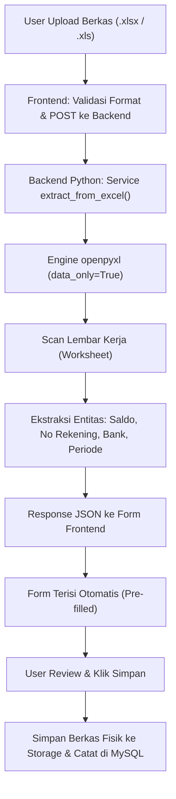
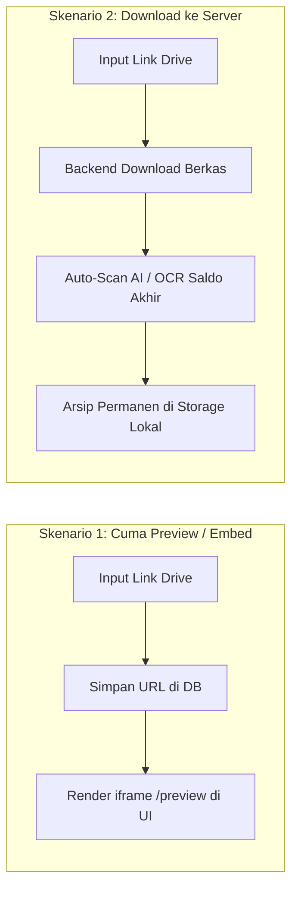
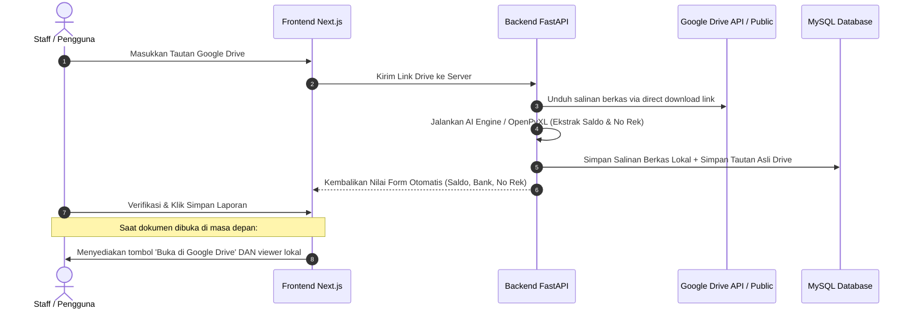

# Panduan Komprehensif: Penanganan Berkas Excel, Analisis Tabel Khusus, dan Integrasi Google Drive

Dokumen ini merangkum seluruh kajian teknis, alur data, arsitektur sistem, serta rekomendasi implementasi terkait penanganan berkas **Excel (.xlsx/.xls)** dan integrasi **Google Drive** pada aplikasi web Rekonsiliasi Rekening Koran & LPJ Kas.

---

## DAFTAR ISI
1. [Bagian 1: Penanganan Unggah Berkas Excel (.xlsx / .xls)](#bagian-1-penanganan-unggah-berkas-excel-xlsx--xls)
   - 1.1 Alur Penerimaan Berkas (Upload Flow)
   - 1.2 Ekstraksi Nilai dengan Engine OpenPyXL
   - 1.3 Alur Penyimpanan Data ke Database MySQL
   - 1.4 Mekanisme Rekonsiliasi Otomatis
2. [Bagian 2: Analisis Tabel Khusus Excel vs Arsitektur Web Saat Ini](#bagian-2-analisis-tabel-khusus-excel-vs-arsitektur-web-saat-ini)
   - 2.1 Arsitektur Web Saat Ini (Model Summary / Ikhtisar)
   - 2.2 Usulan Pembuatan Tabel Khusus Excel (Model Row-by-Row)
   - 2.3 Matriks Perbandingan Teknis
   - 2.4 Rekomendasi Solusi Terbaik
3. [Bagian 3: Integrasi Link Google Drive](#bagian-3-integrasi-link-google-drive)
   - 3.1 Cara Menyambungkan Link Google Drive ke Aplikasi Web
   - 3.2 Transformasi Format URL Google Drive
   - 3.3 Komparasi: Download ke Server vs Cuma Preview / Embed
   - 3.4 Rekomendasi Arsitektur Hybrid (Standar Audit Pemerintah)

---

## BAGIAN 1: Penanganan Unggah Berkas Excel (.xlsx / .xls)

### 1.1 Alur Penerimaan Berkas (Upload Flow)

Saat pengguna (Staff/BPP) memilih berkas berformat spreadsheet (`.xlsx` atau `.xls`) pada form modal unggah:
1. **Frontend Validation (`Next.js / TypeScript`)**:
   - Memvalidasi tipe MIME berkas (`application/vnd.openxmlformats-officedocument.spreadsheetml.sheet` atau `application/vnd.ms-excel`).
   - Mengirim berkas melalui endpoint multipart form-data `POST /api/reconciliation/auto-fill-from-file`.
2. **Backend Processing (`FastAPI / Python`)**:
   - Berkas diterima dalam buffer memori/temporary file.
   - Sistem mendeteksi ekstensi berkas. Jika berakhiran `.xlsx` atau `.xls`, backend mengaktifkan parser spreadsheet `extract_from_excel()`.



### 1.2 Ekstraksi Nilai dengan Engine OpenPyXL

Untuk memastikan formula Excel (seperti `=SUM(...)`, `=SUBTOTAL(...)`) terbaca nilainya dan bukan teks formulanya, backend menggunakan parameter `data_only=True`:

```python
import openpyxl

wb = openpyxl.load_workbook(file_path, data_only=True)
sheet = wb.active # membaca sheet aktif pertama
```

Entitas yang diekstrak secara otomatis:
- **Saldo Akhir**: Melakukan iterasi mundur atau pencarian baris dengan kata kunci `Saldo Akhir`, `Ending Balance`, `Total Saldo`, `Saldo Buku Kas`, mengambil nilai numerik di kolom debit/kredit/saldo.
- **Nama Bank & Kode Bank**: Memeriksa header berkas terhadap kata kunci perbankan (Mandiri, BRI, BNI, BCA, BSI, Bank DKI, Bank Jatim, dll.).
- **Nomor Rekening**: Regex deteksi urutan angka rekening 10-16 digit.
- **Periode Laporan / Bulan**: Deteksi nama bulan (Januari s.d. Desember) dan tahun 4 digit.

### 1.3 Alur Penyimpanan Data ke Database MySQL

Setelah pengguna menekan tombol **"Unggah & Simpan Bukti"**:
1. **Penyimpanan Berkas Fisik**: Berkas Excel disimpan ke folder `backend_py/uploads/` dengan format nama unik `timestamp_namafile.xlsx`.
2. **Pencatatan Dokumen (`dokumen_bukti`)**:
   - `nama_dokumen`: Nama berkas Excel.
   - `file_path`: Path penyimpanan lokal atau URL rujukan.
   - `kategori`: `Rekening_koran` / `Buku_kas_umum`.
   - `tahun`: Tahun anggaran terkait.
   - `status_verifikasi`: Menjalankan alur berjenjang (Staff -> Pimpinan -> Eselon 1).
3. **Pencatatan Saldo Rekening (`rekening_koran`)**:
   - `bank_id`: Relasi ke master data bank.
   - `nomor_rekening`: Nomor rekening yang terdeteksi/dipilih.
   - `bulan`: Periode bulan transaksi.
   - `saldo_akhir`: Angka saldo hasil ekstraksi Excel.
   - `dokumen_id`: Relasi asing (foreign key) ke tabel `dokumen_bukti`.

### 1.4 Mekanisme Rekonsiliasi Otomatis

Data saldo akhir dari berkas Excel yang telah dicatat langsung dibandingkan dengan:
- **Saldo Buku Kas Umum (LPJ Bendahara Pengeluaran)** pada bulan dan rekening yang sama.
- Jika `Saldo Rekening Koran == Saldo Kas Internal`, status otomatis menjadi **Cocok / Sesuai (Matched)**.
- Jika terdapat selisih, sistem mencatat nominal selisih pada tabel `reconciliation_reports` untuk ditindaklanjuti verifikator.

---

## BAGIAN 2: Analisis Tabel Khusus Excel vs Arsitektur Web Saat Ini

### 2.1 Arsitektur Web Saat Ini (Model Summary / Ikhtisar)

Pada sistem yang berjalan saat ini:
- **Konsep**: Web bertindak sebagai **pusat ikhtisar (executive summary) dan validasi saldo akhir**.
- **Penyimpanan**: Berkas Excel/PDF disimpan utuh. Data yang masuk ke tabel database hanya metadata inti: Saldo Akhir, Tanggal Pelaporan, Nomor Rekening, Bank, dan Status Verifikasi.
- **Kelebihan**:
  - Database sangat ringan dan query performa sangat cepat (<10ms).
  - Tampilan dashboard bersih, rapi, dan mudah dipahami pimpinan/eselon 1.
  - Kompatibel dengan semua bank tanpa perlu membuat template parser khusus setiap ada perubahan kolom bank.
- **Kekurangan**:
  - Pimpinan tidak bisa melihat rincian mutasi transaksi baris per baris langsung di halaman web tanpa membuka berkas fisik Excel aslinya.

### 2.2 Usulan Pembuatan Tabel Khusus Excel (Model Row-by-Row)

Jika dibuatkan tabel database khusus (misalnya `transaksi_excel_detail`):
- **Konsep**: Setiap baris mutasi di lembar kerja Excel (misal 500 baris transaksi transfer, setoran, bunga, pajak) dipecah (di-*parse*) dan di-*insert* menjadi 500 baris record ke dalam database.
- **Kelebihan**:
  - Web dapat menyajikan tabel interaktif pencarian transaksi (bisa filter kata kunci mutasi, cari tanggal transaksi tertentu langsung di web).
  - Mampu mendeteksi rekonsiliasi hingga level transaksi per transaksi (transaction-level matching).
- **Kekurangan & Risiko Teknis**:
  - **Masalah Format Berbeda Antar Bank**: Setiap bank memiliki struktur kolom yang tidak seragam (Mandiri Kopra, BRI CMS, BNI Direct, BCA KlikBisnis memiliki posisi header, format tanggal `DD/MM/YYYY` vs `YYYY-MM-DD`, dan urutan debit/kredit yang berbeda-beda).
  - Jika format Excel berubah sedikit saja dari bank, proses import akan gagal atau salah kolom.
  - Beban database melonjak signifikan jika terdapat ratusan rekening dengan ribuan transaksi bulanan.

### 2.3 Matriks Perbandingan Teknis

| Parameter Penilaian | Model Web Saat Ini (Summary Level) | Usulan Tabel Khusus Excel (Row-by-Row) |
| :--- | :--- | :--- |
| **Beban Database & Query** | **Sangat Ringan** (1 record per rekening per bulan) | **Tinggi** (Bisa puluhan ribu record mutasi per bulan) |
| **Resistensi Error Format** | **Sangat Tinggi** (Hanya mencari saldo akhir & no rek) | **Rentan Error** (Gagal jika susunan kolom bank berubah) |
| **Kebutuhan Waktu Development** | **Sudah Berjalan Stabil** | **Tinggi** (Perlu membuat konfigurasi pemetaan kolom dinamis) |
| **Kesesuaian Kebutuhan Pimpinan** | **Sangat Pas** (Pimpinan butuh status klir & saldo akhir) | **Kurang Efisien** (Terlalu detail / data overload untuk eselon) |
| **Fitur Pencarian Mutasi di Web** | Tidak tersedia (harus unduh berkas) | **Tersedia langsung di UI web** |

### 2.4 Rekomendasi Solusi Terbaik

Dua opsi implementasi yang disarankan:

#### Rekomendasi Utama (Opsi A - Model Tab UI Komparasi Saldo):
Pertahankan skema database saat ini agar sistem tetap cepat dan tangguh, namun pada antarmuka pengguna (UI) dibuatkan **Tab Khusus / Modal Viewer**:
1. Menampilkan ringkasan komparasi: Saldo Kas Internal vs Saldo Rekening Koran Excel.
2. Menyediakan tombol cepat **"Preview Isi Berkas Spreadsheet"** yang merender sheet Excel langsung di layar tanpa mengunduhnya ke laptop pengguna.

#### Alternatif Ekstensi (Opsi B - Deep Transaction Parsing):
Jika instansi mewajibkan audit hingga ke nomor resi/referensi mutasi:
- Buat tabel `transaksi_rekening_detail` dengan relasi `foreign_key` ke `dokumen_bukti`.
- Sediakan fitur *Column Mapper* di frontend agar Staff dapat mencocokkan kolom jika format bank berbeda.

---

## BAGIAN 3: Integrasi Link Google Drive

### 3.1 Cara Menyambungkan Link Google Drive ke Aplikasi Web

Pengguna sering kali menyimpan dokumen bukti rekening koran di folder Google Drive instansi dan hanya membagikan tautan berkasnya.

Alur teknis integrasi:
1. Input field baru pada modal form: `"Atau Masukkan Tautan Google Drive"`.
2. Frontend mengekstrak **File ID** menggunakan regular expression:
   ```typescript
   function extractDriveFileId(url: string): string | null {
     const match = url.match(/\/d\/([a-zA-Z0-9_-]+)/);
     return match ? match[1] : null;
   }
   ```
3. Sistem menyimpan URL asli dan File ID ke dalam database.

### 3.2 Transformasi Format URL Google Drive

Google Drive menyediakan URL dengan fungsi berbeda berdasarkan strukturnya:

1. **Tautan Berbagi Standar (View Link)**:
   - Format: `https://drive.google.com/file/d/FILE_ID/view?usp=sharing`
   - Digunakan untuk: Membuka berkas langsung di tab baru browser Google Drive.
2. **Tautan Pratinjau Tersemat (Preview / Embed Iframe)**:
   - Format: `https://drive.google.com/file/d/FILE_ID/preview`
   - Digunakan untuk: Menampilkan dokumen langsung di dalam modal web aplikasi via tag `<iframe>`.
3. **Tautan Unduh Langsung (Direct Download)**:
   - Format: `https://drive.google.com/uc?export=download&id=FILE_ID`
   - Digunakan untuk: Diunduh oleh backend Python secara otomatis guna dilakukan scan saldo/ekstraksi teks.

### 3.3 Komparasi: Download ke Server vs Cuma Preview / Embed

Pertanyaan mendasar: **"Mending di-download ke server atau cuma preview?"**



Berikut perbandingan mendalamnya:

| Skenario | Kelebihan | Kelemahan |
| :--- | :--- | :--- |
| **Opsi 1: Cuma Preview / Embed** | - Server hemat penyimpanan disk.<br>- Proses submit instan tanpa jeda download.<br>- Menghindari duplikasi berkas. | - **Backend AI/OCR TIDAK BISA membaca saldo otomatis**.<br>- Jika file di Drive dihapus atau izin akses diubah jadi *Restricted*, dokumen di web menjadi rusak/tidak bisa dibuka.<br>- Tidak memenuhi standar arsip audit mandiri. |
| **Opsi 2: Download ke Server** | - **Backend Python dapat langsung membaca saldo akhir & nomor rekening**.<br>- Rekonsiliasi otomatis langsung berjalan.<br>- Berkas aman tersimpan permanen sebagai arsip resmi instansi. | - Menggunakan ruang penyimpanan di harddisk server aplikasi.<br>- Butuh koneksi internet dari server ke Google saat proses download. |

### 3.4 Rekomendasi Arsitektur Hybrid (Standar Audit Pemerintah)

Pendekatan terbaik yang sangat direkomendasikan adalah **Sistem Hybrid (Kombinasi Download & Embed)**:



**Alasan Utama Menggunakan Sistem Hybrid:**
1. **Otomatisasi Tetap Berfungsi**: Backend tetap bisa mengekstrak saldo, nama bank, dan rekening koran secara otomatis karena berkas diunduh ke lingkungan backend.
2. **Kepatuhan Audit (Compliance)**: Jika akun Google Drive staf pemilik berkas pensiun, resign, atau foldernya terhapus, instansi tetap memiliki bukti otentik di server lokal.
3. **Fleksibilitas Akses**: Verifikator (Pimpinan/Eselon 1) dapat memilih apakah ingin meninjau langsung di Google Drive atau menggunakan pratinjau internal aplikasi.
