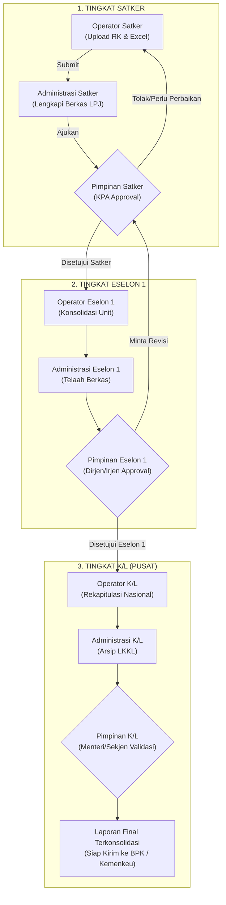

# DOKUMENTASI STRUKTUR PERAN PENGGUNA (USER ROLES & PERMISSIONS)
## Sistem Informasi Pelaporan & Rekonsiliasi Rekening Koran Keuangan Negara

---

## 1. PENDAHULUAN & PRINSIP TATA KELOLA

Sistem ini menerapkan standar tata kelola perbendaharaan dan akuntansi pemerintahan (*e-Government*) berbasis **Segregation of Duties (Pemisahan Tugas)**. Struktur pengguna dirancang untuk memisahkan secara tegas antara pihak yang **melakukan input/operasional data harian** (*Maker*) dengan pihak yang **memiliki wewenang memvalidasi, menyetujui, serta mengawasi** (*Checker & Approver*).

Secara garis besar, sistem dibagi menjadi:
1. **2 Pilar Peran Utama**:
   * **Pilar Operasional**: Pelaksana teknis, pengolah data, pengunggah rekening koran/dokumen, dan administrator sistem.
   * **Pilar Administrasi / Pimpinan**: Pejabat manajerial yang bertugas memonitor user, memonitor pergerakan data/laporan, dan memberikan persetujuan (*approval*) resmi.
2. **3 Tingkatan Entitas Hierarki**:
   * **Tingkat Satker (Satuan Kerja)**: Entitas pelaksana di lapangan (Kampus PTN, Balai, Politeknik, LLDIKTI, Direktorat Teknis).
   * **Tingkat Eselon 1 (Unit Utama Pembina)**: 5 Unit Utama Kementerian (Setjen, Ditjen Dikti, Ditjen Vokasi, Ditjen Saintek, Itjen).
   * **Tingkat K/L (Kementerian / Lembaga)**: Pengelola anggaran tertinggi tingkat kementerian (Menteri / Sekjen / Pengguna Anggaran).

---

## 2. MATRIKS STRUKTUR ROLE LENGKAP

Berikut adalah pemetaan lengkap seluruh peran pengguna di dalam sistem:

| Tingkatan Entitas | Pilar Role | Kode Role | Nama Resmi Peran | Cakupan Lingkup Data (*Scope*) |
| :--- | :--- | :--- | :--- | :--- |
| **Sistem Global** | Operasional | `admin_it` | **IT Administrator** | Seluruh sistem, server, database, audit log, & konfigurasi |
| **Tingkat Satker** | Operasional | `operator_satker` | **Operator Satker** | Terbatas pada 1 Satker tempat bertugas |
| **Tingkat Satker** | Operasional | `administrasi_satker` | **Administrasi Satker** | Terbatas pada 1 Satker tempat bertugas |
| **Tingkat Satker** | Pimpinan | `pimpinan_satker` | **Pimpinan Satker (KPA/PPK)** | Terbatas pada 1 Satker tempat bertugas |
| **Tingkat Eselon 1**| Operasional | `operator_eselon_1` | **Operator Eselon 1** | Seluruh Satker di bawah 1 Unit Eselon 1 naungannya |
| **Tingkat Eselon 1**| Operasional | `administrasi_eselon_1`| **Administrasi Eselon 1** | Seluruh Satker di bawah 1 Unit Eselon 1 naungannya |
| **Tingkat Eselon 1**| Pimpinan | `pimpinan_eselon_1` | **Pimpinan Eselon 1 (Dirjen/Irjen)**| Seluruh Satker di bawah 1 Unit Eselon 1 naungannya |
| **Tingkat K/L** | Operasional | `operator_kl` | **Operator K/L Pusat** | Seluruh Eselon 1 & Seluruh 153+ Satker Nasional |
| **Tingkat K/L** | Operasional | `administrasi_kl` | **Administrasi K/L Pusat** | Seluruh Eselon 1 & Seluruh 153+ Satker Nasional |
| **Tingkat K/L** | Pimpinan | `pimpinan_kl` | **Pimpinan K/L (Menteri/Sekjen)** | Seluruh Eselon 1 & Seluruh 153+ Satker Nasional |

---

## 3. RINCIAN TUGAS & TANGGUNG JAWAB PER ROLE

### A. PILAR OPERASIONAL (PELAKSANA DATA & SISTEM)

#### 1. IT Administrator (`admin_it`)
* **Tanggung Jawab**: Menjaga kestabilan teknis infrastruktur aplikasi, database, dan keamanan akses.
* **Tugas Pokok**:
  * Mengelola akun seluruh pengguna (buat akun, aktifkan/nonaktifkan akun, reset password).
  * Mengelola master data Satker, master Unit Eselon 1, dan master Kategori.
  * Memantau Log Aktivitas sistem secara menyeluruh (*Audit Trail* dan jejak IP).
  * Melakukan *backup* dan pemeliharaan teknis sistem.

#### 2. Operator Satker (`operator_satker`)
* **Tanggung Jawab**: Bertindak sebagai pelaksana entri data harian di tingkat satuan kerja.
* **Tugas Pokok**:
  * Mengunggah file Rekening Koran dari Bank Persepsi / Bank Operasional.
  * Mengunggah file Excel pencatatan transaksi kas internal.
  * Menjalankan proses pencocokan otomatis (*Auto-Reconciliation*) dan mencatat alasan selisih kas jika ada.
  * Mengajukan hasil rekonsiliasi ke bagian Administrasi & Pimpinan Satker.

#### 3. Administrasi Satker (`administrasi_satker`)
* **Tanggung Jawab**: Mengelola penatausahaan berkas dokumen pendukung di tingkat satker.
* **Tugas Pokok**:
  * Mengunggah dokumen pertanggungjawaban (LPJ Bendahara, BKU, SPM/SP2D, bukti setor pajak/PNBP).
  * Memeriksa kelengkapan format dan legalitas berkas sebelum diteruskan ke Pimpinan Satker.
  * Mengelola arsip digital dokumen satker.

#### 4. Operator Eselon 1 (`operator_eselon_1`)
* **Tanggung Jawab**: Mengolah dan mengonsolidasi data rekonsiliasi rekening koran seluruh satker binaan unitnya.
* **Tugas Pokok**:
  * Memeriksa ketercapaian kepatuhan unggah rekening koran satker di bawah unit Eselon 1-nya.
  * Menarik data rekapitulasi selisih saldo antar-satker unit ke format Excel/CSV.
  * Menyiapkan lembar kerja telaah rekonsiliasi untuk Pimpinan Eselon 1.

#### 5. Administrasi Eselon 1 (`administrasi_eselon_1`)
* **Tanggung Jawab**: Tata kelola arsip dan kepatuhan berkas dokumen tingkat unit utama.
* **Tugas Pokok**:
  * Memverifikasi kelengkapan berkas fisik/digital yang dikirimkan oleh satker-satker binaan.
  * Memberikan catatan administrasi berkas sebelum disahkan oleh Pimpinan Eselon 1.
  * Melakukan pengelompokan berkas dokumen satker per kategori dan periode laporan.

#### 6. Operator K/L (`operator_kl`)
* **Tanggung Jawab**: Pelaksana teknis kompilasi dan integrasi data keuangan tingkat kementerian.
* **Tugas Pokok**:
  * Mengelola data konsolidasi saldo kas bank nasional dari seluruh unit Eselon 1 dan satker.
  * Menghasilkan rekapitulasi data rekonsiliasi nasional untuk bahan Laporan Keuangan Kementerian/Lembaga (LKKL).
  * Memantau satker se-Indonesia yang mengalami anomali selisih saldo belum terselesaikan.

#### 7. Administrasi K/L (`administrasi_kl`)
* **Tanggung Jawab**: Administrasi persuratan, SOP, dan arsip induk dokumen kementerian.
* **Tugas Pokok**:
  * Mengelola repositori induk dokumen laporan keuangan seluruh kementerian.
  * Mengatur sirkulasi laporan hasil verifikasi untuk disampaikan kepada auditor eksternal (BPK/Kemenkeu).

---

### B. PILAR ADMINISTRASI / PIMPINAN (MONITORING & PERSETUJUAN)

#### 1. Pimpinan Satker (`pimpinan_satker` - Kuasa Pengguna Anggaran / KPA)
* **Tanggung Jawab**: Penanggung jawab formal pengelolaan keuangan di tingkat satker (Rektor, Direktur, Kepala Balai).
* **Tugas Pokok**:
  * **Monitoring User Satker**: Memantau aktivitas operator dan staf keuangan di lingkungan satkernya.
  * **Persetujuan Data**: Menyetujui atau menolak (*Revisi*) hasil rekonsiliasi rekening koran dan pencatatan satker.
  * **Persetujuan Dokumen**: Menandatangani/memvalidasi dokumen LPJ Bendahara dan laporan keuangan satker agar dapat diteruskan ke Eselon 1.

#### 2. Pimpinan Eselon 1 (`pimpinan_eselon_1` - Direktur Jenderal / Inspektur Jenderal)
* **Tanggung Jawab**: Pengawas dan pembina keuangan tertinggi pada unit utama terkait.
* **Tugas Pokok**:
  * **Monitoring User Unit**: Memantau status login, keaktifan, dan kepatuhan satker-satker binaannya.
  * **Persetujuan Dokumen Satker**: Melakukan *Review & Approval Final* dokumen yang telah disetujui Pimpinan Satker.
  * **Monitoring Selisih Kas**: Memantau daftar satker binaan yang memiliki saldo belum rekonsiliasi (*unreconciled items*).
  * Menetapkan instruksi tindak lanjut bagi satker yang terlambat menyampaikan laporan.

#### 3. Pimpinan K/L (`pimpinan_kl` - Menteri / Sekretaris Jenderal)
* **Tanggung Jawab**: Pemegang kekuasaan pengelolaan keuangan kementerian (Pengguna Anggaran / PA).
* **Tugas Pokok**:
  * **Monitoring Nasional**: Memantau *Executive Dashboard* tingkat kementerian secara menyeluruh (*realtime*).
  * **Persetujuan Laporan Konsolidasi**: Menyetujui laporan rekapitulasi keuangan kementerian sebelum diserahkan ke Kementerian Keuangan (BUN) dan BPK.
  * **Pengambilan Keputusan Strategis**: Mengevaluasi kinerja penyerapan dan kepatuhan akuntansi dari 5 Unit Eselon 1.

---

## 4. DIAGRAM ALUR DATA & PERSETUJUAN BERJENJANG

---

## 5. MATRIKS HAK AKSES SISTEM (CRUD & WORKFLOW PERMISSIONS)

| Aksi / Modul | Operator Satker | Admin Satker | Pimpinan Satker | Operator Eselon 1 | Admin Eselon 1 | Pimpinan Eselon 1 | Operator K/L | Admin K/L | Pimpinan K/L | IT Admin |
| :--- | :---: | :---: | :---: | :---: | :---: | :---: | :---: | :---: | :---: | :---: |
| **Upload Rekening Koran** | ✅ | ❌ | ❌ | ❌ | ❌ | ❌ | ❌ | ❌ | ❌ | ❌ |
| **Upload Catatan Excel** | ✅ | ❌ | ❌ | ❌ | ❌ | ❌ | ❌ | ❌ | ❌ | ❌ |
| **Upload Berkas LPJ/Dokumen**| ❌ | ✅ | ❌ | ❌ | ❌ | ❌ | ❌ | ❌ | ❌ | ❌ |
| **Approval Tingkat Satker** | ❌ | ❌ | ✅ | ❌ | ❌ | ❌ | ❌ | ❌ | ❌ | ❌ |
| **Approval Tingkat Eselon 1**| ❌ | ❌ | ❌ | ❌ | ❌ | ✅ | ❌ | ❌ | ❌ | ❌ |
| **Approval Tingkat K/L** | ❌ | ❌ | ❌ | ❌ | ❌ | ❌ | ❌ | ❌ | ✅ | ❌ |
| **Monitoring Dashboard Satker**| ✅ | ✅ | ✅ | ❌ | ❌ | ❌ | ❌ | ❌ | ❌ | ❌ |
| **Monitoring Dashboard Unit E1**| ❌ | ❌ | ❌ | ✅ | ✅ | ✅ | ❌ | ❌ | ❌ | ❌ |
| **Monitoring Dashboard Nasional**| ❌ | ❌ | ❌ | ❌ | ❌ | ❌ | ✅ | ✅ | ✅ | ✅ |
| **Manajemen Akun User** | ❌ | ❌ | Read | ❌ | ❌ | Read | ❌ | ❌ | Read | CRUD |
| **Log Aktivitas & Audit** | ❌ | ❌ | Unit | ❌ | ❌ | Unit | ❌ | ❌ | Semua | Semua |

---

## 6. IMPLEMENTASI STRUKTUR DATABASE

Untuk mendukung arsitektur peran ini, tabel peran (`roles`) dan pengguna (`users`) dirancang dengan relasi berjenjang:

### Skema Tabel `roles`
* `id`: Primary Key
* `kode`: Kode unik string (misal: `'operator_satker'`, `'pimpinan_eselon_1'`, `'pimpinan_kl'`)
* `nama`: Nama tampilan peran (misal: `'Pimpinan Eselon 1'`)
* `pilar`: ENUM (`'operasional'`, `'pimpinan'`)
* `tingkat`: ENUM (`'satker'`, `'eselon_1'`, `'kl'`, `'sistem'`)
* `deskripsi`: Penjelasan fungsi peran

### Skema Tabel `users`
* `id`: Primary Key
* `nama`: Nama lengkap pegawai / pejabat
* `username`: Akun login
* `email`: Alamat email dinas
* `password_hash`: Hash sandi terenkripsi (Bcrypt)
* `role_id`: Relasi ke tabel `roles`
* `satker_id`: ID Satker (diisi untuk user tingkat Satker, `NULL` untuk tingkat di atasnya)
* `eselon_1_id`: ID Satker Eselon 1 (diisi untuk user tingkat Eselon 1 dan Satker binaannya)
* `is_active`: Status keaktifan akun (1 = aktif, 0 = nonaktif)
* `created_at` & `updated_at`: Waktu pencatatan akun

---
*Dokumen ini merupakan acuan resmi standar hak akses dan alur kerja pengguna dalam sistem pelaporan & rekonsiliasi satker.*
